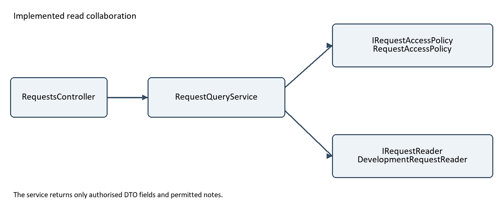

# CivicConnect PED v4.0 Final

18 October 2026. Part III closes the original project. The following retained M1–M3 content records its earlier milestone context.

<!-- Markdown copy of PED_v3.0.docx. Matching PDF: PED_v3.0_Updated.pdf. -->

# CivicConnect Project Engineering Document

Version 3.0 Controlled Construction Integration Quality and Release Readiness

Virtual Group K | SEN381 | 15 October 2026

Cameron Purdon 601963 | Bianca Grobler 600537 | Michael Ellis 600332

This document continues PED v2.0 into Milestone 3, retaining the approved requirements, architecture decisions and project history. It records PostgreSQL persistence, protected request retrieval, authorised status updates, automated verification and a separate database-read performance test. The release-readiness assessment and supporting evidence are presented in Section 14.

## Document control

| Version | Date and provenance | Change |
| --- | --- | --- |
| 1.0 | Supplied main PED1; M1 history retained | Problem, scope, 27 requirements, 54 acceptance criteria, RTM, risks and working agreement retained in Part I. |
| 2.0 architecture draft | 24 September 2026; Bianca contribution, PR #10 | ASRs, architecture, State direction and R-008 to R-045. |
| 2.0 data and technology draft | Michael PR #11; approved by two distinct peers on 29 September | PostgreSQL data direction; MVC/Razor/EF Core stack; deployment considerations. |
| 2.0 | 30 September 2026; consolidated by Cameron Purdon and reviewed by Bianca Grobler and Michael Ellis | M1 continuity retained; M2 architecture, data, technology, design, integration, RTM, application documentation and verification evidence consolidated. |
| 3.0 | 15 October 2026; team M3 scope agreement confirmed by Cameron; PR17 approvals and successful main CI recorded. | Personal 19/29/25 checks and PERF-01 retained; CONDITIONALLY READY for the agreed M3 increment in simulated staging; original gaps retained for M4 finalisation. |

## Navigation

Part I retains the M1 foundation. Part II continues the M2 architecture and decisions with dated M3 implementation and verification updates. Original M2 checkpoint statements remain identifiable; the M3 subsections describe the latest evidence. The separate RTM remains the controlled requirements matrix.

Controlled supporting artefacts include docs/CivicConnect_RTM_v2.0.xlsx, docs/decisions/README.md and README.md.

| Evidence area | Location in this PED |
| --- | --- |
| Persistence | 5.4.14 and 7.2-7.7: implementation, decisions, database verification and integrated workflow. |
| Conformance and quality | 5.3.1, 5.6.1, 7.8.1, 11.2-11.3 and 14: architecture, rule-test design, risks, debt and release judgement. |
| API and verification | 5.6.2, 5.7.2, 7.8.2-7.10, 8-10, 12.1 and 15: access/API, execution evidence, technical documentation, traceability and submission record. |

## Part I Retained M1 engineering foundation

Part I retains the M1 wording and requirements baseline. Part II records current decisions, evidence and limitations. No requirement or acceptance criterion has been changed.

## 1. Problem, Stakeholder Analysis and Business Value

### 1.1 Problem Statement

Community service requests may currently be managed through fragmented communication and record-keeping channels, including email, telephone calls, WhatsApp messages, spreadsheets and paper-based processes. This can result in requests being duplicated, lost or overlooked and makes it difficult to maintain visibility of a request throughout its lifecycle (SEN381 Teaching Team, 2026a, section 2).

The fragmented process also creates challenges in assigning responsibility, prioritizing requests and determining whether requests have been addressed. Furthermore, management may have limited access to reliable information regarding open, overdue, resolved and closed requests. The inconsistent handling of request information can also introduce security and information management concerns.

CivicConnect is intended to address these problems by providing a centralized platform for managing community service requests. The platform will provide a controlled lifecycle in which requests can be submitted, categorized, viewed by authorized users, assigned, updated, resolved and closed.

### 1.2 Stakeholder Analysis

The primary stakeholders are community requesters, service staff, and management.

Community requesters are individuals who submit community service requests. Their key needs are a simple request-submission process, meaningful status information, access to their request history, and appropriate feedback regarding their requests.

Service staff are responsible for processing and resolving service requests. They require access to authorized requests, search and filtering capabilities, request details, assignment and responsibility controls, controlled status updates, action or resolution recording, and the ability to resolve and close requests.

Management requires an overview of service activity and performance. Their needs include information about open, overdue, resolved and closed requests, analysis by category and status, and information that supports accountability and service-performance analysis (SEN381 Teaching Team, 2026a, section 3).

Other stakeholders include system administrators and project team. Administrators have an interest in system control, access, and security. The project team requires clear and manageable requirements and scope.

### 1.3 Business Value

CivicConnect is expected to create value by centralizing service request information and providing a controlled request lifecycle. Centralization can improve visibility and reduce the likelihood of requests being lost or overlooked. Assignment and responsibility features can improve accountability, while status tracking can improve transparency for requesters (SEN381 Teaching Team, 2026a, section 2.1).

The platform can also provide management with structured information about service activity, enabling analysis of request categories, statuses and service performance. Overall, the intended business value is to improve the control, visibility, accountability and transparency of community service request management.

## 2. Scope Baseline & Constraints

### 2.1. Scope Baseline

#### 2.1.1 In Scope (M1 committed baseline)

Requester capabilities

SR-IN-01: Submit a new service request with category, description and location.

SR-IN-02: Categorise a request using a controlled, predefined category list.

SR-IN-03: View current status of own submitted requests.

SR-IN-04: View history/list of previously submitted requests.

SR-IN-05: Receive feedback when a request is accepted, rejected, updated or completed.

Staff capabilities

SR-IN-06: View requests relevant to the staff member's role/category.

SR-IN-07: Search, filter and sort requests (by status, category, date, priority).

SR-IN-08: View full request detail.

SR-IN-09: Assign or accept ownership of a request.

SR-IN-10: Update request status through defined, controlled transitions (e.g. New → Assigned → In Progress → Resolved → Closed).

SR-IN-11: Record comments/actions/resolution notes against a request.

SR-IN-12: Resolve/close requests where authorised.

Management capabilities

SR-IN-13: View aggregate service activity (open/overdue/resolved/closed counts).

SR-IN-14: View requests by category/status/other justified dimension.

SR-IN-15: Access enough data to support basic accountability and performance reporting.

#### 2.1.2 Out of Scope

| Excluded item | Reason |
| --- | --- |
| Direct integration with WhatsApp, email inbox or telephone systems | High integration complexity and third-party API/security risk relative to available schedule; the platform replaces these channels rather than connecting to them. |
| Payment processing | No transactional/payment business need identified in the scenario. |
| Native mobile applications | Responsive web meets the business need at lower cost/schedule risk than a separate native build. |
| Multi-organisation/multi-tenant support | Scenario describes a single organisation; multi-tenancy adds data-isolation complexity with no stated need. |

Deliberate exclusion defended: WhatsApp/email/telephone integration is excluded because it requires third-party credentials, rate limits and message-parsing logic that amount to a separate project, introduces external attack surface the team can't fully control, and isn't necessary to solve the actual problem — fragmentation is solved by giving every channel one destination (the platform), not by the platform reaching into every channel.

#### 2.1.3 Deferred / Future Scope

SR-FUT-01: Automated SLA-breach escalation/reminders.

SR-FUT-02: Public API for third-party integration.

SR-FUT-03: AI-assisted automatic categorisation.

SR-FUT-04: Native mobile application.

SR-FUT-05: Multi-language interface.

SR-FUT-06: File and photo attachments.

Any of these entering scope later goes through formal Change Management (Change Request → Impact Analysis → Decision → Authorise → Implement → Verify → Update Baseline), not informal addition.

### 2.2. Assumptions & Constraints

#### 2.2.1 Assumptions

| ID | Assumption | Why it matters if wrong |
| --- | --- | --- |
| A-01 | Staff and management users have basic digital literacy and reliable internet/device access | Affects UI complexity and support burden if untrue |
| A-02 | The organisation has a single, relatively stable set of service categories at launch | Affects how rigid vs. configurable the category system needs to be |
| A-03 | A free/low-cost hosting tier is sufficient for pilot-scale usage volumes | Affects cost planning and NFR realism |
| A-04 | The team retains full access to a GitHub account and free-tier services for the project duration | Affects continuity of controlled evidence if untrue |

#### 2.2.2 Constraints

| Constraint | Statement | Engineering Implication |
| --- | --- | --- |
| Schedule | Fixed 4-milestone academic delivery period; no extension available. | Favours a smaller, controlled feature set over a larger unfinished one; drives §1.2 exclusions. |
| Cost | Team must prefer free/low-cost services. | Free-tier limits (storage, connections, cold-start/sleep behaviour) must be documented as an operational risk, not ignored. |
| Scope | Baseline in §1.1 is controlled; changes require formal impact analysis. | Prevents uncontrolled creep from ad hoc add requests during construction. |
| Quality | Quality attributes must be defined now and evidenced later. | NFRs must be specific and testable (e.g. response time, concurrent users), not vague claims. |
| Security | Sensitive requester data must be protected from first commit, not retrofitted. | Drives early decisions on authentication, role-based access and secrets handling (see §4). |

#### 2.2.3 Constraint Interaction / Trade-off

Schedule vs. Security (access-control granularity): A fully granular, field-level permission system would better satisfy least-privilege principles but isn't achievable within the fixed schedule alongside required functional scope. Accepted trade-off: a coarser three-role model (Requester / Staff / Management) with feature-level rather than field-level access control. This is a deliberate, evidence-based decision recorded in Michael's Engineering Decision Log, with residual risk tracked below (R-004).

## 3. Requirements &Acceptance Criteria

The requirements below are based on the stakeholder needs in section 1.2 and scope in section 2.1. High priority covers the core workflow, dependencies and security controls. Medium priority follows these foundations but remains part of the planned scope (SEN381 Teaching Team, 2026a, section 11).

FR identifies a functional requirement and NFR a non-functional requirement. Each has two acceptance criteria, labelled AC followed by its requirement ID and 1 or 2. Sources and scope links are recorded in the accompanying RTM.

### 3.1 Functional requirements

FR-001 Submit a service request (High)

Allow requesters to submit a request with a category, description and location.

AC-FR-001-1: A valid submission saves one request with a unique reference, date and New status.

AC-FR-001-2: Missing required fields or an invalid category are rejected without saving a request.

FR-002 Controlled request categories (High)

Use a predefined list of request categories.

AC-FR-002-1: A requester can select and save a category from the agreed list.

AC-FR-002-2: An unlisted category is rejected; existing requests retain their saved category.

FR-003 View own request status (High)

Allow requesters to view the current status of their own requests.

AC-FR-003-1: After an authorised update, the requester sees the saved status and update date.

AC-FR-003-2: Entering another requester’s reference does not reveal its status or details.

FR-004 View own request history (Medium)

Allow requesters to view their previous requests.

AC-FR-004-1: The list shows each own request’s reference, category, date and current status, including completed requests.

AC-FR-004-2: Other users’ requests are excluded; an empty list displays a clear message.

FR-005 Requester feedback (Medium)

Provide requester feedback when a request is accepted, rejected, updated or completed.

AC-FR-005-1: Each event produces feedback showing the event, date and current status; rejection and completion include a reason or summary.

AC-FR-005-2: Feedback remains available later and excludes private staff notes and other users’ information.

FR-006 Authorised staff request list (High)

Allow staff to view requests permitted by their role and assigned categories.

AC-FR-006-1: Staff see all and only the requests allowed by their permissions.

AC-FR-006-2: Direct access to a request outside these permissions is denied.

FR-007 Search, filter and sort (Medium)

Allow staff to search requests and filter by status, category, date and priority, and sort by date or priority.

AC-FR-007-1: Searches and combined filters return only matching authorised records, including both date-range boundaries.

AC-FR-007-2: Sorting gives the expected order; clearing filters restores the list and no matches displays an empty result.

FR-008 Full request details (High)

Allow authorised staff to view full request details.

AC-FR-008-1: Details show the reference, requester, category, description, location, date, status, priority, owner, due date and notes.

AC-FR-008-2: Unauthorised users cannot open the same details; missing owner or due date is clearly shown.

FR-009 Assign or accept ownership (High)

Allow authorised staff to assign a request or accept responsibility for it.

AC-FR-009-1: Assignment records one eligible owner, the person making the change and the time.

AC-FR-009-2: Ineligible owners are rejected; simultaneous attempts to claim a request cannot create two owners.

FR-010 Controlled status transitions (High)

Allow request status changes only through the agreed lifecycle.

AC-FR-010-1: Allowed changes save the new status, previous status, actor and time.

AC-FR-010-2: Invalid transitions and changes by unauthorised users are rejected without changing the request.

FR-011 Record actions and notes (High)

Allow staff to record comments, actions and resolution notes against a request.

AC-FR-011-1: A nonblank entry is saved with its author and time; blank entries are rejected.

AC-FR-011-2: Requester-visible updates reach the requester; internal notes remain private and corrections preserve earlier entries.

FR-012 Resolve and close requests (High)

Allow authorised staff to resolve and close requests.

AC-FR-012-1: Resolving an In Progress request requires a resolution summary and records the actor and time.

AC-FR-012-2: Only an authorised user can close a Resolved request; other closure attempts are rejected.

FR-013 Service activity summary (Medium)

Allow management to view counts of open, overdue, resolved and closed requests.

AC-FR-013-1: Counts match a known dataset using the stated lifecycle and overdue rules.

AC-FR-013-2: Refreshing shows saved changes, including zero counts; requesters cannot access organisation-wide totals.

FR-014 Management category/status analysis (Medium)

Allow management to view requests and counts by category and status.

AC-FR-014-1: Category and status selections show only matching requests and correct counts.

AC-FR-014-2: Clearing selections restores the permitted overview; categories with no matches show zero.

FR-015 Accountability and performance history (High)

Keep request history to support accountability and basic performance reporting.

AC-FR-015-1: History records creation, ownership, status, priority, due-date and note changes with actor and time.

AC-FR-015-2: History survives restart and cannot be silently changed by ordinary users; timestamps support elapsed-time calculations.

FR-016 Authenticated role access (High)

Authenticate users and apply Requester, Staff and Management permissions.

AC-FR-016-1: Valid credentials for an enabled account grant the agreed access; invalid credentials grant no session.

AC-FR-016-2: Signed-out users cannot access protected functions, and users cannot grant themselves extra permissions.

FR-017 Request priority (Medium)

Record a controlled priority for each request and allow authorised staff to change it.

AC-FR-017-1: A new request receives the default priority; permitted changes are saved and appear in sorting and filtering.

AC-FR-017-2: Unlisted priorities and requester attempts to change priority are rejected.

FR-018 Due dates and overdue identification (Medium)

Allow staff to record due dates and identify overdue requests.

AC-FR-018-1: A valid due date and any change to it are saved with actor and time; invalid dates are rejected.

AC-FR-018-2: Only open requests past their due time are overdue; requests without a due date are clearly marked.

### 3.2 Non-functional requirements

NFR-001 Access-control isolation (High)

Protect requests using role and record-level access controls.

AC-NFR-001-1: The role/access test set produces zero unauthorised disclosures or changes, including direct requests.

AC-NFR-001-2: Requester ownership and staff-category boundaries are enforced while authorised actions succeed.

NFR-002 Pilot response time (Medium)

Complete at least 95% of submissions, status views, staff searches and management summaries within 3 seconds at pilot load, with at most 1% failures.

AC-NFR-002-1: Test with 10 concurrent users and 1,000 requests for 10 minutes after a 2-minute warm-up, with at least 100 runs per operation.

AC-NFR-002-2: Measure each operation separately from user action to visible result; record failures, environment and cold-start time separately.

NFR-003 Data integrity on save (High)

Save request data and its history together without partial updates.

AC-NFR-003-1: A failed submission, assignment or status change leaves either the complete change or the previous state.

AC-NFR-003-2: Saved records survive restart; a double-click submission does not create duplicate requests.

NFR-004 Requester usability (Medium)

Make request submission and status checking easy for users with basic digital skills.

AC-NFR-004-1: At least four of five representative participants submit a valid request and find its status within five minutes without coaching.

AC-NFR-004-2: All participants use the same task; completion times and errors are recorded.

NFR-005 Responsive and keyboard-usable interface (Medium)

Provide a responsive web interface that supports keyboard use.

AC-NFR-005-1: At 360 px and 1366 px viewport widths in Chrome and Edge, controls remain readable and usable without page-level horizontal scrolling.

AC-NFR-005-2: Keyboard users can reach and operate core controls, see focus, submit a request and read validation errors.

NFR-006 Protected data in transit (High)

Use HTTPS to protect authentication and request data in deployed environments.

AC-NFR-006-1: Sign-in and protected pages use a valid certificate with no mixed-content requests.

AC-NFR-006-2: HTTP is redirected or denied without protected content; application-generated credentials and request data use HTTPS only.

NFR-007 Recoverable request records (Medium)

Support recovery with no more than 24 hours of lost data and restoration within four hours.

AC-NFR-007-1: A restore test meets both targets and recovers consistent request, ownership, status and history records.

AC-NFR-007-2: The backup age, restoration time and resulting records are recorded for verification.

NFR-008 Privacy of logs and errors (High)

Keep sensitive information out of application logs and error messages.

AC-NFR-008-1: Tests using dummy secrets and private request content reveal none of that content in logs or user-facing errors.

AC-NFR-008-2: Errors identify the failed action without exposing credentials, connection secrets or internal stack traces to users.

NFR-009 Testability of core business rules (High)

Allow core request rules to be tested with controlled data in a separate test environment.

AC-NFR-009-1: Submission, access, assignment, status and reporting rules accept test inputs and produce observable results without production data.

AC-NFR-009-2: Repeating a check from the same starting state gives the same outcome; deliberately invalid behaviour is detected.

### 3.3 Requirements consistency and scope check

The requirements were compared with the supplied stakeholder analysis and scope. Each of the 15 in-scope items has a corresponding functional requirement. File and photo attachments are deferred to future scope. FR-016 to FR-018 support access control, priority filtering and overdue reporting already required by the scope (SEN381 Teaching Team, 2026a, section 3).

| Stakeholder or scope area | Requirements and coverage |
| --- | --- |
| Requesters | FR-001–FR-005 cover submission, categories, status, history and feedback (SR-IN-01–05). |
| Staff | FR-006–FR-012 cover permitted requests, search, details, assignment, updates, notes and closure (SR-IN-06–12). |
| Management | FR-013–FR-015 cover counts, category/status analysis and accountability (SR-IN-13–15). |
| Security and quality | FR-016–18 and NFR-001–09 support permissions, reporting rules, performance, usability, reliability and testing. |

Each requirement has a unique ID, a source, a priority and two testable acceptance criteria. Public feedback is separated from internal staff notes to protect confidential information. Performance and recovery targets guide the selection of suitable free or low-cost hosting.

Lifecycle: Requests follow New → Assigned → In Progress → Resolved → Closed. A New request may be rejected with a recorded reason. Open requests are those marked New, Assigned or In Progress. Reopening is not included.

Permissions and feedback: Requesters can view their own requests and public updates. Staff can access requests permitted by their role and assigned categories. Management can access service reporting. Feedback is provided within the application, while internal staff notes remain private. Email notifications are not included in the initial version.

Categories: The initial categories are Facility Faults, Damaged Equipment, Security Concerns, IT Support, Maintenance, Lost Property and Other. Each request must use one category from this list.

Priority and overdue rules: Priorities are Low, Normal and High, with Normal as the default. Authorised staff can change priorities and set due dates. An open request is overdue when its due time has passed. Requests without a due date are clearly identified and are not counted as overdue. Automatic escalation remains deferred.

Attachments: File and photo uploads are deferred to future scope to limit storage, security and implementation work. Initial submissions contain a category, description and location.

Quality targets: The numerical performance, usability and recovery targets in section 3.2 are the acceptance targets for the pilot. Hosting options will be assessed against these targets during M2. Any changes to the targets must follow the project’s change-control process. Achievement will be demonstrated through testing in later milestones.

External messaging integrations, payments, multi-tenant support and native apps are excluded from the initial version. Attachments, automated escalation, public APIs, AI categorisation and multilingual support remain future scope. Technology and architecture decisions will be addressed in M2.

## 4. RTM & Traceability Foundation

The initial Requirements Traceability Matrix (RTM) is supplied in the Excel spreadsheet called Cameron_M1_Requirements_RTM (3).xlsx.  It links all 27 requirements to their stakeholder/source, scope, priority and acceptance criteria. The Requirements sheet contains the full wording; the RTM sheet holds the trace links and future evidence fields.

For example, the requester’s need to submit and track a request in section 1.2 links to SR-IN-01, then FR-001 and AC-FR-001-1/2. These criteria check that a valid request is saved with a reference and that invalid input is rejected. NFR-003 supports this by preventing partial saves.

| RTM field | Content |
| --- | --- |
| Requirement ID and source | Unique ID, stakeholder, source section and scope reference. |
| Priority and acceptance | Requirement priority and linked acceptance criterion IDs. |
| Design and implementation | References to later designs, issues, pull requests and code. |
| Test, change and release | Links to test results, approved changes and release evidence. |
| Implementation status | Progress from Not Started through implementation and verification. |

At M1, implementation status is Not Started and later evidence fields contain Not yet created. These entries reflect the milestone’s focus on requirements and planning. The initial RTM establishes the current trace links and provides space for later lifecycle evidence.

The team maintains one evolving RTM. Requirement approval is recorded through the PED baseline process, separately from implementation status. A requirement is marked Verified only when its acceptance checks pass and supporting evidence is linked.

Changes are assessed for their effects on scope, acceptance criteria, related requirements and later design or tests. Approved changes are then reflected in the RTM. For example, changing the definition of “open” affects FR-010, FR-013 and FR-018. Traceability is also checked backwards to ensure that tests and changes link to the requirements they support (SEN381 Teaching Team, 2026a, sections 11 and 14).

## 5. Risk & Forward Engineering Considerations

### 5.1. Initial Risk Register

#### R-001

Description: Schedule slip due to unfamiliarity with the chosen technology stack

Cause: Limited prior team experience with selected tools

Assessment: Probability: Medium; Impact: High; Priority: High; Owner: Bianca; Status: Open.

Mitigation: Time-boxed technical spike in M1/early M2 before committing; pair on unfamiliar areas

Contingency: Fall back to a stack the team already knows

#### R-002

Description: Free-tier hosting/database limits exceeded during dev, testing or demo

Cause: Shared free-tier storage/connection/uptime restrictions

Assessment: Probability: Medium; Impact: Medium; Priority: Medium; Owner: Cameron; Status: Open.

Mitigation: Monitor usage against tier limits from the start; keep data footprint lightweight

Contingency: Migrate to an alternate/paid tier before a milestone demo

#### R-003

Description: Uncontrolled scope creep from informal "quick add" requests

Cause: Stakeholders/lecturer suggest additions outside baseline

Assessment: Probability: Medium; Impact: High; Priority: High; Owner: Michael; Status: Open.

Mitigation: Enforce formal Change Request + Impact Analysis before any addition

Contingency: Defer to Future Scope (§1.3) if impact analysis shows schedule risk

#### R-004

Description: Sensitive requester data exposed due to coarse role-based access control

Cause: Deliberate schedule-driven simplification (see §2.3)

Assessment: Probability: Low; Impact: High; Priority: High; Owner: Team; Status: Open.

Mitigation: Enforce least-privilege at feature level; review every access-control change; test each role's boundaries

Contingency: Revoke/patch access immediately if a gap is found; document as incident

#### R-005

Description: Secrets/credentials accidentally committed to GitHub

Cause: Missing .gitignore/environment-variable discipline

Assessment: Probability: Medium; Impact: High; Priority: High; Owner: Michael; Status: Open.

Mitigation: .gitignore from repo creation; environment variables/secret storage; never hardcode

Contingency: Rotate exposed credentials immediately; purge from git history

#### R-006

Description: Uneven team contribution causes one member to fall behind before a deadline

Cause: Workload conflicts, personal circumstances, poor visibility

Assessment: Probability: Medium; Impact: Medium; Priority: Medium; Owner: Team; Status: Open.

Mitigation: Weekly check-ins; visible task board; early flagging of blockers

Contingency: Redistribute tasks; document contribution evidence

#### R-007

Description: AI-assisted output contains unverified or incorrect claims

Cause: Over-reliance on AI without independent verification

Assessment: Probability: Medium; Impact: Medium; Priority: Medium; Owner: Whoever used the AI tool; Status: Open.

Mitigation: Log every material AI contribution in the AI Usage Register; verify before acceptance

Contingency: Rework the artefact manually if verification fails

Highest-priority risk to defend: R-005 (secrets exposure) — impact is severe and, unlike R-001/R-003, mitigation is fully within the team's control from day one, so there's no excuse for it materialising.

### 5.2. Forward Engineering Considerations

#### 1

Concern: Authentication & authorisation model

Why it matters now: Requirements must anticipate what auth needs to support later; retrofitting is expensive

Later decision it influences: M2 architecture, M3 RBAC implementation

Missing information: Final tech stack; whether institutional/SSO login is expected

Risk of ignoring it: Insecure access control bolted on late

#### 2

Concern: Data persistence & schema evolution

Why it matters now: Requirements should anticipate what must be stored and how it may grow

Later decision it influences: M2 data/persistence design

Missing information: Realistic data volume/growth for the pilot

Risk of ignoring it: Poor schema causing costly migration/rework

#### 3

Concern: Deployment/hosting platform selection

Why it matters now: Free-tier limits constrain what's realistic to promise in NFRs now

Later decision it influences: M2 technology decision, M3 CI/CD and environments

Missing information: Comparative cost/limits of candidate platforms

Risk of ignoring it: Committing to NFRs the eventual platform can't support

#### 4

Concern: Automated testing & CI approach

Why it matters now: Acceptance criteria written now should anticipate automation, not just manual checks

Later decision it influences: M3 CI pipeline and quality gates

Missing information: Team's tooling familiarity, available CI minutes

Risk of ignoring it: Tests bolted on late reduce coverage/confidence

#### 5

Concern: Requester notification mechanism

Why it matters now: Whether feedback (SR-IN-05) is in-app, email, or both affects architecture and dependencies

Later decision it influences: M2 architecture/integration design

Missing information: Stakeholder preference, cost of email-sending services

Risk of ignoring it: Architecture assumes a channel that isn't feasible/affordable

#### 6

Concern: Personal data handling / privacy obligations

Why it matters now: Requester contact details/request content are personal data requiring careful handling from schema design onward

Later decision it influences: M2 data design, M3 security assurance

Missing information: Applicable institutional/legal data-protection expectations

Risk of ignoring it: Non-compliant handling discovered late

#### 7

Concern: Rollback/recovery expectations

Why it matters now: Even a pilot system needs a plan for "what if a bad release breaks it"

Later decision it influences: M3/M4 deployment and operations

Missing information: Whether the chosen platform supports easy rollback

Risk of ignoring it: No safe way to recover from a bad deploy near a milestone deadline

Deliberately deferred, not decided: None of the above commits the team to a technology, schema or architecture in M1, consistent with the M1 boundary that "thinking ahead is not premature implementation." Each is recorded so it shapes NFRs/risk now and is revisited with evidence in M2.

## 6.Project Approach & Team Working Agreement

#### Project Approach

The CivicConnect project will use a controlled, iterative Agile approach. The approach allows the team to develop the system progressively while maintaining control over requirements, changes, quality, risks and project evidence (Beck et al., 2001).

The project will progress through the four defined milestones: Engineering Foundation and Requirements Baseline, Architecture and Design, Controlled Construction and Integration, and the Final Product and Engineering Defence.

During M1, the team will establish the engineering foundation by defining the problem, stakeholders, scope, requirements, acceptance criteria, constraints, risks and initial engineering decisions. These outputs will form the M1 baseline and provide the foundation for subsequent project work.

During M2, the baselined requirements will be used to develop and justify the system architecture, design and technology decisions.

During M3, the team will implement and integrate the system incrementally. Development work will be managed using GitHub Issues and branches. Substantive changes will be submitted through Pull Requests and reviewed by other team members before being merged into the protected main branch. Testing and quality activities will occur throughout construction rather than being left until the end of development.

During M4, the team will validate the completed product against the agreed requirements and acceptance criteria, evaluate project success, address remaining risks and technical debt, and prepare the final engineering defence.

#### Iterative Development Process

Individual items of work will follow a controlled cycle:

- Identify and define the required work.

- Record the work as a GitHub Issue.

- Assign responsibility to a team member.

- Develop the change on a separate branch.

- Test and verify the change.

- Submit a Pull Request.

- Obtain meaningful peer reviews and required approvals.

- Address review findings.

- Merge the approved change into the protected main branch.

- Update relevant documentation, requirements traceability and project evidence.

This approach provides a balance between Agile flexibility and the engineering controls required by the project. Requirements and implementation can evolve when justified, while changes remain traceable and controlled. Risks, defects and important engineering decisions will be recorded and reviewed throughout the project.

The team will not treat completion of functionality alone as evidence of completion. Work will be considered complete when the relevant implementation, testing, review, documentation and traceability evidence have been addressed.

#### Team Working Agreement

The CivicConnect team agrees to work collaboratively and maintain shared responsibility for the quality and success of the project. Individual responsibilities will be allocated to team members, but all members remain responsible for understanding the overall system and being able to explain the team's engineering decisions and artefacts.

## 1. Communication

- Team members will communicate regularly using the team's agreed communication channel.

- Important project decisions will be documented rather than relying only on informal conversations.

- Team members will communicate as soon as possible if they are unable to complete an assigned task or encounter a significant problem.

## 2. Meetings

- The team will hold regular project meetings to review progress, upcoming work, risks and problems.

- Meeting outcomes and significant decisions will be recorded where appropriate.

- Team members will attend agreed meetings and contribute to discussions.

## 3. Task Allocation

- Engineering work will be represented using GitHub Issues where appropriate.

- Tasks will be assigned to specific team members to establish accountability.

- Work will be divided according to workload and project requirements rather than allowing one member to become responsible for an entire area of the system.

- Team members will keep their GitHub Issues updated as work progresses.

## 4. GitHub and Code Changes

- Team members will work using branches rather than making substantive changes directly to main.

- Substantive changes will be submitted through Pull Requests.

- Pull Requests will require review by other team members before merging.

- Reviewers will provide meaningful feedback rather than approving changes without inspection.

- The Pull Request author will not count their own approval.

- Team members will not commit passwords, API keys, private keys or other sensitive credentials to the repository.

## 5. Quality and Testing

- Team members are responsible for testing the work they produce.

- Defects discovered during development will be recorded and addressed appropriately.

- Code will be reviewed before being incorporated into the controlled baseline.

- The team will not deliberately reduce required testing or security activities simply to meet a deadline.

## 6. Documentation and Traceability

- Requirements, risks and significant engineering decisions will be documented.

- Changes to baseline requirements will follow the project's change-control process.

- Team members will maintain evidence of their contributions through GitHub commits Issues, Pull Requests, reviews and relevant documentation.

- The PED will be maintained as a single integrated engineering document.

## 7. AI Usage

- AI tools may be used where appropriate to support project activities.

- Material AI-assisted contributions will be recorded in the AI Usage Register.

- AI-generated content and code will be reviewed and verified by the team before being accepted.

- Team members remain responsible for understanding and being able to explain any AI-assisted work they use.

## 8. Collaboration and Knowledge Sharing

- Each team member will remain familiar with the overall CivicConnect system and not only their assigned tasks.

- Team members will explain important technical or engineering decisions to the rest of the team.

- Team members will support one another when difficulties arise.

- No team member will intentionally withhold information required for another member to complete their work.

## 9. Conflict Resolution

- Technical disagreements will be discussed using project requirements, evidence, risks and engineering reasoning.

- Where the team cannot immediately agree, alternatives will be considered and the decision will be documented where it represents a significant engineering choice.

- Personal disagreements will not be allowed to interfere with project responsibilities.

## 10. Accountability

Each team member agrees to:

- Complete their assigned work within agreed timeframes.

- Maintain evidence of their contributions.

- Review other team members' work when requested.

- Communicate problems early.

- Participate in project meetings and milestone preparation.

- Understand the overall project sufficiently to defend the team's work.

- Take responsibility for the quality of their contributions.

#### Agreement

By adopting this working agreement, all three team members agree to follow the practices above throughout the CivicConnect project. The agreement may be updated when project circumstances change, if changes are discussed and agreed upon by the team and appropriately documented.

## 7. Initial Engineering Decision Log

### 7.1. Initial Deployment & Operational Considerations

#### 7.1.1 Environments to anticipate

| Environment | Purpose at this stage |
| --- | --- |
| Development | Each team member's local setup; not yet standardised: to be agreed in M2. |
| Test | Anticipated for automated checks introduced in M3; not implemented yet. |
| Staging | Anticipated as a production-like rehearsal step before any real release; platform not yet chosen. |
| Production | Not applicable in M1, no real users or real data yet. |

#### 7.1.2 Operational questions the team is holding open (not deciding yet)

- What free-tier hosting/DB option will be evaluated first, and against what criteria (cost, ease of use, team familiarity)?

- What minimum logging is needed to know a request was created/updated, for later accountability evidence?

- What would "the system is degrading" look like for CivicConnect specifically (e.g. requests silently failing to save)?

- Who is responsible for secrets/config once a real deployment target is chosen?

#### 7.1.3 Why this matters at M1

Recording these questions now, without answering them, means the M2 technology/architecture decision can be made with operational readiness in mind, rather than discovering in M3 that the chosen platform can't support staging, logging, or rollback the team assumed it would.

## 8. GitHub Governance, Team Accountability & AI Controls

#### GitHub Governance and Team Accountability

GitHub is used as the controlled repository for the CivicConnect project. The repository has been configured with controls intended to protect the project baseline, support collaborative development and provide evidence of team accountability.

#### Protected Main Branch

The main branch is protected so that substantive changes cannot be made directly to the controlled baseline. Changes must be submitted through a Pull Request before being merged. A minimum of two approvals from team members other than the Pull Request author is required before a substantive change can be merged. This provides peer review and reduces the risk of unreviewed or unsuitable changes being incorporated into the project baseline.

#### .gitignore

A .gitignore file has been configured to prevent unnecessary generated files and development-specific files from being committed to the repository. The team will also ensure that passwords, API keys, private keys and other sensitive credentials are not committed to the repository.

#### GitHub Issues

GitHub Issues are used to record and manage engineering work. Issues represent project tasks, defects, requirements-related work and other activities requiring attention. This provides visibility of work allocation and progress and creates a link between project work and the team's development activities.

#### Purpose of the Controls

These controls provide a structured development process in which project work can be assigned, changes can be reviewed and the controlled project baseline can be protected. They also provide traceable evidence of team participation through Issues, branches, Pull Requests, reviews and commits.

The GitHub governance approach will be maintained throughout the project and updated, when necessary, as the project progresses through subsequent milestones.

#### Reference List:

Beck, K. et al. (2001) Principles behind the Agile Manifesto. Available at: https://agilemanifesto.org/principles.html (Accessed: 9 September 2026).

SEN381 Teaching Team (2026a) SEN381 CivicConnect Master Project Brief. Version 1.1. Belgium Campus iTversity. Supplied course material.

SEN381 Teaching Team (2026b) SEN381 CivicConnect Project: Milestone 1 — Engineering Foundation & Requirements Baseline. Belgium Campus iTversity. Supplied course material.

#### AI Research & Verification Record

#### Michael Ellis

AI tool/use: ChatGPT

Purpose: To find an effective way to track who is responsible for different tasks and provide evidence

Output used?: Yes – The suggestion to use GitHub Issues

How independently verified: The approach was reviewed against the project requirements

What was changed/rejected: Other tracking methods suggestions were not used; GitHub Issues was selected because it provides clear task ownership and traceable evidence

#### Cameron Purdon

AI tool/use: ChatGPT

Purpose: To understand and explain work and break it down with explanations.

Output used?: Yes – Small pieces of information was used and structure format

How independently verified: The information was compared to online sources and lecture notes

What was changed/rejected: Certain information was rejected due to being too wordy or not completely relevant.

#### Bianca Grobler

AI tool/use: ChatGPT

Purpose: To create tables for the risk register

Output used?: Yes- the tables were used

How independently verified: It was reviewed against the project requirements

What was changed/rejected: Tables that were too complex and not needed were rejected

## Part II Milestone 2 baseline and Milestone 3 continuation

The original M2 decisions and acceptance targets below are retained. Dated M3 updates extend the same record; earlier planned or pending implementation statements describe their original checkpoint. Michael's supplied M3 persistence sections retain his 12 October checkpoint, followed by the current 13 October integration and release evidence.

### 4 Continued documentation and baseline review

Part II integrates Bianca's architecture contribution, Michael's data, technology and deployment contribution, and Cameron's design, integration, traceability and documentation contribution.

The newer main PED explicitly defers file/photo attachments as SR-FUT-06, matching the workbook. This resolves the older handover discrepancy without changing requirements. Open means New, Assigned or In Progress; reopening, email integration, public APIs, automated escalation and multi-tenancy remain outside initial scope.

### 4.1 Continued engineering documentation and change record

| Record | Approved baseline change and reason |
| --- | --- |
| C-M2-01 | Continued the M1 requirements baseline in PED v2.0. Requirement and acceptance-criteria wording was retained, while historical M1 status was distinguished from current M2 status. |
| C-M2-02 | Updated the request-lifecycle decision using the Assignment 2 finding that lifecycle rules should be separated from resulting actions. The comparison between State and a transition table is recorded as an M2 architecture decision. |
| C-M2-03 | Refined the State decision to match the approved scope. Reopening remains outside the current scope, access control is handled separately, and transaction integrity remains a persistence responsibility. |
| C-M2-04 | Corrected the requirement reference associated with R-014. R-013 now records the need for central server-side authorisation, while R-017 records the separation of requester-visible information from private staff notes. |
| C-M2-05 | ADR-M2-06 selects explicit application-service coordination for required status, history and feedback operations. Durable transactional writes remain planned. |
| C-M2-06 | Bianca Grobler and Michael Ellis reviewed the consolidated PED v2.0 and supporting M2 evidence. The team accepted the documented baseline for submission on 30 September 2026. |
| C-M2-07 | Added the protected request-read implementation, application structure and 29 passing local verification checks as initial M2 development evidence. |

#### 4.2 RTM evolution

CivicConnect_RTM_v2.0.xlsx retains the Requirements sheet, all FR-001 to FR-018 and NFR-001 to NFR-009 identifiers, priorities and 54 acceptance criteria. The RTM keeps original trace fields and adds quality-driver, architecture, data/persistence, technology, risk and current-wording columns. A2 evidence stays in ADRs rather than becoming an assignment-completion column.

FR-003, FR-008, FR-011, FR-016, NFR-001, NFR-008 and NFR-009 are In Development with partial local evidence. All others remain Planned. No row is Verified. Requirement approval, implementation progress and acceptance completion remain different claims. FR-011 evidence covers note confidentiality on reads, not note creation; FR-016 has a framework gate, not a real login flow.

### 5.2 Architecturally Significant Requirements & Quality Drivers

The following requirements materially shaped the M2 architecture decision. They were selected because each one constrains a structural choice, not because they are the only quality attributes CivicConnect has.

| Quality Driver (ASR) | Linked Requirement(s) | Why It Matters for CivicConnect | Architectural Influence |
| --- | --- | --- | --- |
| Access-control isolation | NFR-001, FR-016, FR-006, FR-008 | Requesters, staff and management share one platform but must never see each other's data or functions beyond their role (M1 R-004: coarse-role trade-off). | Requires a single, centralised authorisation checkpoint server-side, not scattered across the UI. Rules out client-only enforcement. |
| Data integrity on save | NFR-003, FR-009, FR-010 | Concurrent assignment attempts and status changes must never corrupt a request or create two owners. | Requires business logic and data-access layers to enforce atomic operations; drives the state-based transition decision in §5.6. |
| Pilot-scale performance | NFR-002 | 95% of core operations must complete within 3s at pilot load (10 concurrent users), not enterprise scale. | Justifies a proportionate architecture: a distributed/microservice split adds latency and operational overhead this workload does not need. |
| Testability of business rules | NFR-009 | Status, assignment and reporting rules must be verifiable with test data independent of the UI, ahead of M3 automated testing. | Requires business logic to be separated from presentation and persistence so rules can be unit-tested in isolation. |
| Maintainability under schedule/team-size constraint | Schedule constraint (§2.2.2); R-001, R-006 | Three students, one fixed academic schedule, no extension; unfamiliar-technology risk already logged in M1. | Favours a single, well-structured deployable unit over a distributed architecture the team cannot realistically build, test and defend at this scale (see §5.3, "Proportional architecture"). |

### 5.3 Architecture Decision, Alternatives & Diagrams

Proportional architecture note: a more distributed architecture is not automatically more advanced. The alternatives below were evaluated directly against the ASRs in §5.2, the M1 schedule and cost constraints (§2.2.2), and the team-capability risk already logged as R-001.

| Option | Description | Decision | Reason |
| --- | --- | --- | --- |
| A. Microservices (per bounded context: Requests, Users, Reporting) | Independently deployable services communicating over the network, each with its own data store. | Rejected | Disproportionate operational and integration complexity for a 3-person team, a fixed 4-milestone schedule and free-tier hosting; contradicts the M2 guidance that a more distributed architecture is not automatically more advanced (§5.3). |
| B. Client-side application with direct database access | Browser application connects to the database with no server-side application layer. | Rejected | Cannot satisfy NFR-001 (access-control isolation) or NFR-003 (data integrity) because authorisation and validation cannot be trusted if enforced only in the client. |
| C. Layered (n-tier) web application: presentation, application/API, business logic, data access, single relational data store, deployed as one unit | A single deployable application internally divided into layers with clear responsibilities and one controlled entry point for business rules. | Selected | Proportionate to team capability and schedule; centralises access control and data-integrity enforcement server-side (NFR-001, NFR-003); keeps business logic separately testable (NFR-009); deployable within free-tier constraints (A-03). |

#### Logical View: Layered Architecture

Distinguishes logical responsibility layers from the physical deployment tiers below. Each layer only calls the layer directly beneath it.

| Presentation Layer: Web UI (Requester / Staff / Management views) |
| --- |

↓

| Application / API Layer: request handling, authentication and authorisation checkpoint (NFR-001) |
| --- |

↓

| Business Logic Layer: request lifecycle rules including StatusTransitionService (ADR-M2-02), assignment rules, reporting logic |
| --- |

↓

| Data Access Layer: repository/data-access abstraction (protects NFR-009 testability) |
| --- |

↓

| Single Relational Data Store |
| --- |

#### Physical View: Deployment Tiers

Shown separately from the logical view per the M2 requirement to distinguish architecture from physical deployment. Specific hosting platform is owned by Michael's technology-stack decision (§5.5/§5.8); this view anticipates a single deployable application unit consistent with ADR-M2-01.

| Client device (browser): Requester / Staff / Management |
| --- |

↓

| Single hosted application instance (presentation + API + business logic + data access) |
| --- |

↓

| Managed relational database service (free/low-cost tier, A-03) |
| --- |

#### ADR-M2-01: Overall Application Architecture

Decision ID: ADR-M2-01: Overall Application Architecture

Context: CivicConnect requires a controlled request lifecycle shared by three distinct roles (requester, staff, management) and must be built, tested and defended by a 3-person team within a single fixed academic schedule.

Constraints: Fixed 4-milestone schedule (no extension); free/low-cost hosting preference (A-03); team unfamiliarity risk with new tools (R-001); NFR-001 access isolation; NFR-003 data integrity; NFR-009 testability.

Alternatives Considered: See §5.3 alternatives table: (A) Microservices, (B) Client-side app with direct DB access, (C) Layered n-tier monolithic web application.

Decision: Adopt Option C: a layered (n-tier) web application, made up of a presentation layer, an application/API layer, a business logic layer and a data-access layer, deployed as a single unit against one relational data store.

Rationale: Centralises authorisation and validation server-side, keeps business rules independently testable, and matches team capability and schedule realism better than a distributed alternative.

Trade-offs: A single deployable unit is a simpler operational model but does not allow independently scaling or deploying individual capabilities; accepted because pilot-scale load (NFR-002) does not require this, and the team's schedule cannot absorb the added operational complexity of independent services.

Risks: See Risk Register R-008 (layer-skipping under schedule pressure), R-009 (business logic coupled to persistence framework), R-010 (over-engineering pressure).

Evidence: Repository folder structure aligned to layers (to be committed under §7 development evidence); RTM architecture/module column populated once implementation begins.

Later Consequence (M3 review, 14 October 2026): Layering is retained in MVC services and EF Core adapters. Bianca Grobler completed conformance review of Cameron and Michael’s combined work and confirmed the tested architecture decisions. TD-04 is closed for the architecture-consequence review; one-project dependency enforcement and normal Staging startup remain qualified. See 5.3.1 and docs/reviews/Bianca_M3_Final_Review_Updated.docx.

### 5.3.1 Milestone 3 Architecture Conformance Review

The M3 conformance record compares ADR-M2-01 and ADR-M2-02 with the implemented MVC services, access policy, State component and relational persistence. The original architectural direction is retained; the principal implementation consequence is an explicit coordinator for approved status changes.

| Original decision | Implemented consequence | Evidence and limitation |
| --- | --- | --- |
| ADR-M2-01: one layered web application and relational store | MVC delegates to application services, a central policy and EF Core/PostgreSQL adapters. Required status effects share one transaction. | Source folders and E01/E02/A05. Layers share one project; dependency enforcement is logical rather than a separate-assembly boundary. |
| ADR-M2-02: State controls legal transitions | The missing six-state component was added as an integration dependency. State checks legality, the coordinator checks permission, and the writer commits approved changes. | C01/C02/C04 and E01/E02. Future low-level-writer bypass remains a documented design risk. |

Bianca Grobler completed the conformance review on 14 October 2026 for the combined implementation baseline 3760605089cd19e5f44412c5438cb3015984d574. The layered, State and central-policy/API decisions conform for tested paths. Her review closes R-047 for the tested lifecycle matrix and TD-04 for reviewed architecture consequences, retaining deployment, identity and future-route limitations. Credible simulated staging is permitted by M3 scope section 14; normal Program startup remains a documented environment difference.

No reopening or new requirement is introduced. The record connects each original decision to an implementation observation and consequence; passing checks establish selected behaviour rather than architectural enforcement in every future route.

### 5.4 Data & Persistence Baseline

ADR-M2-01 establishes CivicConnect as a layered web application using a single relational data store. This section refines that architectural decision into the initial data model, ownership rules, integrity and consistency strategy, and persistence technology decision.

The persistence baseline is driven particularly by NFR-003 (data integrity on save), NFR-007 (recoverable request records), NFR-009 (testability), FR-009 (assignment), FR-010 (controlled status transitions), FR-011 (actions and notes) and FR-015 (accountability and performance history).

#### 5.4.1 Core Entities and Responsibilities

The following entities are required by the current CivicConnect requirements.

| Entity | Responsibility | Key Data |
| --- | --- | --- |
| User | Represents authenticated Requester, Staff and Management users. | UserId, Name, Email, PasswordHash, Role, IsActive |
| Category | Provides the single controlled list of service-request categories. | CategoryId, Name, IsActive |
| ServiceRequest | Central business record containing the current state of a community service request. | RequestId, ReferenceNumber, RequesterId, CategoryId, Description, Location, Status, Priority, AssignedStaffId, DueDate, CreatedAt, UpdatedAt |
| RequestNote | Records comments, actions and resolution information against a request. | NoteId, RequestId, AuthorId, Content, IsRequesterVisible, CreatedAt |
| RequestHistory | Provides an append-only audit history of significant request changes for accountability and reporting. | HistoryId, RequestId, ActorId, ChangeType, PreviousValue, NewValue, CreatedAt |
| RequesterFeedback | Stores feedback that may be viewed by the requester following relevant lifecycle events. | FeedbackId, RequestId, EventType, Message, CreatedAt, IsRead |

ServiceRequest is the central business record. The current state is kept separately from RequestHistory so that the application can efficiently access the current request while retaining historical evidence of significant changes.

RequestNote distinguishes between requester-visible and internal information using an explicit visibility field. This supports AC-FR-011-2, which requires requester-visible updates to reach the requester while internal staff notes remain private.

The separate Category entity provides one controlled source for the seven categories defined in M1 and reduces the risk of inconsistent category values identified in R-019.

#### 5.4.2 Relationships and Data Ownership

The initial relationships are:

- One User acting as a requester may submit many ServiceRequests.

- Each ServiceRequest belongs to one requester.

- Each ServiceRequest belongs to one Category.

- One Category may be associated with many ServiceRequests.

- A ServiceRequest may be assigned to one staff user at a time.

- One staff user may be responsible for multiple ServiceRequests.

- One ServiceRequest may contain many RequestNotes.

- Each RequestNote has one author.

- One ServiceRequest may contain many RequestHistory records.

- Each RequestHistory record identifies the actor responsible for the change where applicable.

- One ServiceRequest may contain many RequesterFeedback records.

ServiceRequest owns the lifecycle of its request-specific history, notes and feedback from a domain perspective. User and Category records remain independent reference records because they may be associated with multiple requests.

Historical records must not be silently modified or removed by ordinary application users. RequestHistory is therefore treated as append-only application data. Corrections should create further traceable information rather than rewriting historical evidence.

Hard deletion of ServiceRequests is not part of the current normal request lifecycle. The approved lifecycle ends at Closed, allowing completed requests and their history to remain available for accountability and reporting.

#### 5.4.3 Initial Logical Schema

The initial logical schema is:

User

- UserId — Primary Key

- Name — Required

- Email — Required, Unique

- PasswordHash — Required

- Role — Required

- IsActive — Required

Category

- CategoryId — Primary Key

- Name — Required, Unique

- IsActive — Required

ServiceRequest

- RequestId — Primary Key

- ReferenceNumber — Required, Unique

- RequesterId — Foreign Key → User

- CategoryId — Foreign Key → Category

- Description — Required

- Location — Required

- Status — Required

- Priority — Required, default Normal

- AssignedStaffId — Nullable Foreign Key → User

- DueDate — Nullable

- CreatedAt — Required

- UpdatedAt — Required

RequestNote

- NoteId — Primary Key

- RequestId — Foreign Key → ServiceRequest

- AuthorId — Foreign Key → User

- Content — Required

- IsRequesterVisible — Required

- CreatedAt — Required

RequestHistory

- HistoryId — Primary Key

- RequestId — Foreign Key → ServiceRequest

- ActorId — Foreign Key → User

- ChangeType — Required

- PreviousValue — Nullable

- NewValue — Nullable

- CreatedAt — Required

RequesterFeedback

- FeedbackId — Primary Key

- RequestId — Foreign Key → ServiceRequest

- EventType — Required

- Message — Required

- CreatedAt — Required

- IsRead — Required

This represents the initial M2 schema baseline rather than an immutable final schema. Schema changes discovered during implementation will be introduced through controlled migrations and reviewed against the RTM, ADRs and Risk Register where they affect a baselined decision.

#### 5.4.4 Controlled Reference Data and Request Lifecycle

The persistence model must support the controlled values established in the M1 baseline.

Request lifecycle:

New → Assigned → In Progress → Resolved → Closed

A New request may additionally be rejected with a recorded reason. Reopening a closed request remains outside the current scope.

Priority values:

Low | Normal | High

Normal is the default priority.

Initial categories:

- Facility Faults

- Damaged Equipment

- Security Concerns

- IT Support

- Maintenance

- Lost Property

- Other

Categories will be maintained through the Category reference entity rather than repeated as uncontrolled text throughout the application. Existing requests retain their relationship to their stored category.

Status-transition validity remains the responsibility of the business logic defined by ADR-M2-02 rather than being independently reimplemented in the persistence layer.

#### 5.4.5 Integrity, Transactions and Concurrency

CivicConnect requires integrity controls at both the application and persistence levels.

Primary keys uniquely identify records. Foreign keys maintain relationships between requests and associated users, categories, notes, feedback and history. Required values use non-null constraints where absence would create an invalid record, while unique constraints protect values such as user email addresses and request reference numbers.

The application layer remains responsible for business-rule validation. Database constraints provide an additional integrity boundary and should not replace the business logic established by the layered architecture.

NFR-003 requires a request change and its associated history to be saved without partial updates. Operations such as request creation, assignment and status changes will therefore use transactional persistence where multiple related writes form one business operation.

For example:

Update ServiceRequest status + Create RequestHistory entry = one atomic operation

If either part fails, the complete operation must be rolled back so that the database remains in its previous consistent state.

Concurrency is particularly important for AC-FR-009-2, which states that simultaneous attempts to claim a request must not create two owners. The implementation must therefore detect competing updates and allow only one valid assignment to succeed.

The exact concurrency implementation will be confirmed during the technology-stack implementation spike, but the persistence design requires a concurrency-control mechanism rather than relying only on UI checks.

This addresses R-015 and will be verified through a concurrent-assignment test during implementation.

#### 5.4.6 Data Access Boundary

ADR-M2-01 separates business logic from persistence through the Data Access Layer. Business logic should therefore not communicate directly with the database.

The initial responsibility flow is:

Presentation → Application/API → Business Logic → Data Access → Relational Database

The Data Access Layer will contain the persistence-specific implementation required to query and save data. Business rules such as valid status transitions, assignment permissions and requester access must remain outside the persistence implementation.

This separation supports NFR-009 because core business rules can be tested independently of the production database and reduces the persistence-coupling risk identified in R-009.

#### 5.4.7 Persistence Technology Alternatives

ADR-M2-01 has already established that CivicConnect will use a single relational data store. The M2 persistence decision therefore compares realistic relational database technologies rather than reopening the relational-versus-document-database architecture decision.

| Criterion | PostgreSQL | SQL Server | SQLite |
| --- | --- | --- | --- |
| Relational model and constraints | Strong fit | Strong fit | Supported |
| Transaction support | Strong | Strong | Supported |
| Multi-user hosted web application | Suitable | Suitable | Less suitable as the primary hosted database |
| .NET ecosystem compatibility | Supported | Strong | Supported |
| Local development | Supported | Supported | Very simple |
| Hosted deployment options | Widely available | Available | Normally application-local |
| Pilot reporting/filtering needs | Strong fit | Strong fit | Suitable at smaller/local scale |
| Cost consideration | Open-source database; hosting cost depends on provider | Edition/hosting choice must be considered | No separate DB server required |
| CivicConnect fit | Strong | Strong | Better suited to local/simple persistence than the intended shared hosted system |

#### 5.4.8 Persistence Decision

Selected direction: PostgreSQL relational database

PostgreSQL is selected as the current persistence technology for CivicConnect, subject to the final technology-stack and deployment compatibility checks in §5.5 and §5.8.

The decision is based on the following project-specific factors:

- CivicConnect contains strongly related data including users, requests, categories, notes, feedback and historical records.

- NFR-003 requires transactional consistency between request changes and their associated history.

- Foreign-key and constraint support aligns with the required ownership and integrity rules.

- FR-007, FR-013, FR-014 and FR-015 require filtering, aggregation, reporting and historical queries that fit a relational model.

- The application is intended to be a shared hosted web system rather than a single-machine application.

- PostgreSQL provides a path from development to hosted relational persistence while retaining a standard relational model.

SQL Server remains a technically viable alternative and may offer particularly close integration with a .NET technology stack. It was not selected as the initial direction because CivicConnect should retain flexibility when evaluating free/low-cost database hosting under A-03.

SQLite offers the simplest local setup and may still be useful for isolated development or testing. It is not selected as the primary shared persistence technology because CivicConnect is intended to operate as a multi-user hosted web application with a separate managed relational data store under ADR-M2-01.

The decision will be revisited through controlled change if the §5.5 or §5.8 evidence shows that the selected application or deployment technology creates a significant incompatibility.

#### 5.4.9 Availability, Scalability and Database SPOF

The single relational database is a potential Single Point of Failure because CivicConnect depends on it for request submission, status changes, assignments, history and management reporting.

A distributed database architecture is not justified for the current pilot. NFR-002 defines a pilot load of 10 concurrent users and 1,000 requests. Adding replication or distributed persistence at this stage would increase operational complexity without evidence that the pilot requires it.

The initial strategy is therefore to use one appropriately managed relational database and to address availability through backup/recovery, deployment-platform capability and controlled failure handling.

Fields commonly involved in searching, filtering and reporting, such as reference number, status, category, requester and relevant dates, are candidates for indexing. Actual indexes beyond uniqueness requirements should be confirmed against representative queries rather than added without evidence.

Performance testing in a later milestone will determine whether query optimisation, indexing, connection-pool configuration or hosting changes are necessary.

This section directly relates to R-016, which tracks the possibility of free-tier connection limits affecting NFR-002 testing.

#### 5.4.10 Backup and Recovery

NFR-007 requires recovery with:

- Recovery Point Objective (RPO): no more than 24 hours of lost data

- Recovery Time Objective (RTO): restoration within four hours

The final deployment/database service must provide a backup and recovery approach capable of satisfying these targets.

The exact hosted backup mechanism is not baselined in §5.4 because it depends on the deployment platform selected in §5.8. The deployment evaluation must therefore verify backup availability rather than assume that a free database tier includes suitable recovery functionality.

A later milestone must demonstrate recovery through a controlled restore test and record the backup age, restoration time and resulting database state.

This decision is tracked through R-018.

#### 5.4.11 Data Security and Privacy

CivicConnect stores requester identity information and request content and must therefore maintain access-control and privacy boundaries established in M1.

Requesters may access only their own requests and requester-visible information. Staff access is constrained by the authorised role/category model, while management receives access required for reporting and accountability.

Where application-managed authentication is used, plaintext passwords must never be persisted. Only appropriately generated password hashes will be stored.

Database credentials and connection strings containing secrets must not be committed to the repository. Configuration will use the environment/secrets strategy selected under §5.5 and §5.8.

Database exceptions must also be handled without exposing connection details, credentials, stack traces or private request content to users or inappropriate logs, supporting NFR-008.

Relevant existing risks include R-017, R-031, R-034 and R-035.

#### 5.4.12 Schema Evolution and Migration Strategy

Schema changes will be introduced using version-controlled database migrations rather than undocumented manual changes to a shared database.

The initial migration should establish:

- User

- Category

- ServiceRequest

- RequestNote

- RequestHistory

- RequesterFeedback

- primary keys

- foreign-key relationships

- required/nullable constraints

- unique constraints

- initial controlled Category data where appropriate

Migration artefacts will be committed to GitHub and reviewed through the team's normal branch and Pull Request process.

A material schema change must trigger review of affected requirements, the RTM, Risk Register and ADRs before the updated structure becomes part of the controlled baseline.

This provides the traceability path:

Requirement → Data/Persistence Decision → Schema/Migration → Implementation → Test Evidence

#### 5.4.13 Initial Implementation Evidence

The following implementation evidence is required before this decision should be treated as fully evidenced:

| Evidence | Current M2 Status |
| --- | --- |
| Entity/domain model | Planned |
| Initial relational schema/ERD | Planned |
| Data-access project/layer | Planned |
| PostgreSQL development connection | Planned |
| Initial database migration | Planned |
| Controlled Category seed data | Planned |
| Transactional request/history save spike | Planned |
| Concurrent assignment test/spike | Planned |
| GitHub Issue, commits and Pull Request | Planned |

Until these artefacts exist in the repository, the implementation status must remain Planned rather than being represented as implemented.

#### 5.4.14 Milestone 3 Persistence Implementation and Verification

Implementation Overview

During Milestone 3, CivicConnect progressed from the planned PostgreSQL persistence architecture established in Milestone 2 to a working database-backed implementation. PostgreSQL 17 was configured as the relational database, with Entity Framework Core 8 and the Npgsql provider used for data access within the ASP.NET Core application.

The implementation includes persistent service requests, requester-visible and internal notes, and request status-history records. Entity Framework Core migrations provide controlled database schema evolution.

Concurrency and Data Integrity

Optimistic concurrency control was implemented using a version property on service requests. When a request is updated, its version increases. If a competing operation attempts to save an outdated version, Entity Framework Core raises a concurrency exception, preventing the conflicting update from silently overwriting the previously saved change.

The EfRequestStatusWriter component implements transactional persistence for status updates. A successful operation saves the request's updated status, a status-history entry and requester-visible feedback as one database transaction.

If a required database write fails, the transaction is rolled back, leaving the previously committed database state unchanged.

Verification Evidence

A dedicated PostgreSQL database integration test executable was developed to verify persistence behaviour using controlled test records.

The local integration test run completed 25 checks successfully, covering database connectivity, request retrieval, note visibility, access-control behaviour, concurrency detection, status-history persistence, successful transactional updates and rollback after a deliberately triggered database failure.

The existing verification suite had previously completed 29 checks successfully, giving 54 passing checks across the local test runs.

The GitHub Actions verification workflow was extended to support a temporary PostgreSQL test database. A workflow run on the feature/m3-data-persistence branch completed successfully, providing independent CI execution evidence.

Implementation Scope and Limitations

The raw persistence adapter does not independently authorise users or decide legal transitions. The implemented application coordinator supplies those checks before saving; the personal component/API/system cases verify the supported status path.

The current tests demonstrate selected database integrity and persistence behaviours. They do not yet establish complete acceptance of FR-010, FR-011, FR-015 or NFR-003, including all lifecycle, audit-history and duplicate-submission requirements.

The simulated test host exercises Staging configuration and HTTPS. Normal Staging web startup, recovery acceptance and pilot-load performance are not established by the recorded evidence.

Supporting Evidence

src/CivicConnect.Web/Data/EfRequestStatusWriter.cs

src/CivicConnect.Web/Data/Entities/

src/CivicConnect.Web/Migrations/

tests/CivicConnect.DatabaseTests/Program.cs

.github/workflows/verify.yml

GitHub Actions successful workflow run: View CI evidence

#### ADR-M2-03: Data & Persistence Strategy

ADR Field: Decision Record

Decision ID: ADR-M2-03: Data & Persistence Strategy

Context: ADR-M2-01 establishes a layered web application using a single relational data store. CivicConnect requires structured relationships between users, requests, categories, notes, feedback and history, while NFR-003 requires atomic persistence and FR-015 requires durable accountability history.

Constraints: Fixed academic schedule; free/low-cost service preference (A-03); NFR-002 pilot performance target; NFR-003 data integrity; NFR-007 recovery target; NFR-009 testability; layered architecture established by ADR-M2-01.

Alternatives Considered: PostgreSQL, SQL Server and SQLite.

Decision: Adopt PostgreSQL as the current relational persistence technology. Use a structured relational schema, version-controlled migrations and a separate Data Access Layer. Treat RequestHistory as append-only application history and use transactional persistence for business operations that modify current request state and history together.

Rationale: PostgreSQL supports the relational, transactional and query requirements of CivicConnect while remaining compatible with the project's free/low-cost deployment constraint. The design also maintains the separation between business logic and persistence established by ADR-M2-01.

Trade-offs: A server-based relational database introduces configuration, migration, connection, backup and deployment responsibilities compared with an embedded database such as SQLite. The additional complexity is accepted because CivicConnect is intended to operate as a shared multi-user hosted application.

Risks: R-014, R-015, R-016, R-017, R-018, R-019, R-025 and R-037.

Evidence: Initial ERD/schema, migration, PostgreSQL connection spike, transactional save spike and GitHub PR. Evidence currently Planned until committed.

Later Consequence (M3 update, 13 October 2026): PostgreSQL migrations, version checks and transactional status/history/feedback writes are implemented. Twenty-five database checks pass locally. Broader audit, idempotency and recovery remain incomplete; see 5.4.14, 7.3 and 7.9.

### 5.5 Technology-Stack Decision

The technology-stack decision implements the layered architecture established in ADR-M2-01 and the relational persistence strategy established in ADR-M2-03.

The selected stack must support CivicConnect's responsive web interface, server-side authentication and authorisation, independently testable business rules, relational persistence, transactional data operations and later deployment to a free or low-cost environment.

The decision is also constrained by the fixed academic schedule, the team's ability to implement and defend the selected technologies, NFR-001 access-control isolation, NFR-002 pilot performance, NFR-003 data integrity, NFR-005 responsive interface requirements, NFR-006 HTTPS, NFR-008 privacy of logs/errors and NFR-009 testability.

#### 5.5.1 Technology Requirements

The technology stack must provide:

- a responsive browser-based user interface;

- server-side request processing;

- server-side authentication and authorisation;

- separation between presentation, business logic and persistence;

- relational database access;

- transaction support;

- database migration support;

- automated testing support;

- environment-specific configuration and secrets handling;

- HTTPS compatibility;

- dependency/version management;

- compatibility with the selected deployment approach; and

- a realistic development workflow for the three-person project team.

The stack should remain proportionate to the CivicConnect pilot rather than introducing technologies that increase implementation and deployment complexity without addressing a current requirement.

#### 5.5.2 Candidate Application Stacks

Three realistic application-stack directions were considered.

| Criterion | C# / ASP.NET Core | Java / Spring Boot | JavaScript / Node.js |
| --- | --- | --- | --- |
| Server-side web development | Strong | Strong | Strong |
| Layered architecture support | Strong | Strong | Strong |
| Relational persistence support | Strong | Strong | Strong |
| Authentication/authorisation ecosystem | Strong | Strong | Strong |
| Automated testing support | Strong | Strong | Strong |
| PostgreSQL compatibility | Strong | Strong | Strong |
| Dependency management | NuGet | Maven/Gradle | npm |
| Development complexity | Moderate | Moderate | Moderate |
| Suitability for CivicConnect | Strong | Strong | Strong |

All three alternatives are technically capable of implementing CivicConnect. The decision therefore depends not only on technical capability but also on how effectively the team can implement, test, maintain and defend the chosen stack within the fixed project schedule.

#### 5.5.3 Selected Technology Stack

The proposed CivicConnect technology stack is:

| Layer / Concern | Selected Technology | Purpose |
| --- | --- | --- |
| Programming language | C# | Primary application language |
| Web framework | ASP.NET Core MVC | Server-side web application structure and request handling |
| Presentation | Razor Views, HTML, CSS and JavaScript | Responsive browser-based interface |
| Application/API layer | ASP.NET Core Controllers / application services | Request handling and server-side access-control boundary |
| Business logic | C# service/domain classes | Request lifecycle, assignment and reporting rules |
| Data access | Entity Framework Core | ORM and relational data-access implementation |
| Database | PostgreSQL | Relational persistence established in ADR-M2-03 |
| PostgreSQL provider | EF Core-compatible PostgreSQL provider | Connects EF Core to PostgreSQL |
| Authentication/authorisation | ASP.NET Core authentication/authorisation facilities | Authentication and Requester/Staff/Management access control |
| Testing | .NET testing framework | Unit and integration testing |
| Dependency management | NuGet | Package/version management |
| Source control | Git / GitHub | Controlled development evidence and collaboration |

The exact framework, runtime, provider and package versions will be recorded once the team's development environment is bootstrapped and the compatibility spike has been completed. Pre-release versions will not be used unless a specific project requirement justifies them.

#### 5.5.4 Frontend Decision

CivicConnect will use a server-rendered web interface using ASP.NET Core MVC with Razor Views, supported by HTML, CSS and limited client-side JavaScript where required.

A separate single-page application framework is not currently required by the approved CivicConnect requirements.

The primary interface requirements are that users can submit and track requests, staff can manage requests and management can access reporting information. NFR-005 additionally requires the interface to operate at 360 px and 1366 px viewport widths and remain keyboard usable.

Using the same application stack for the web presentation and server-side application reduces the number of independently configured technologies the team must integrate and maintain.

Client-side validation may improve usability, but security and business validation must also occur server-side. The browser must therefore never be treated as the only enforcement point for permissions or data-integrity rules.

#### 5.5.5 Backend Decision

C# with ASP.NET Core is selected for the application/API and business-logic layers.

The backend will implement:

- authentication and authorisation;

- service-request operations;

- assignment;

- request status processing;

- notes and feedback;

- reporting;

- validation;

- transaction coordination; and

- communication with the Data Access Layer.

This maintains the responsibility separation established in ADR-M2-01.

Controllers should coordinate incoming web requests but should not contain the complete CivicConnect business rules. Business rules should be placed in appropriate application/domain services so that they remain independently testable under NFR-009.

For example:

Controller → StatusTransitionService → Data Access → Database

rather than:

Controller → directly changes database status

This also supports ADR-M2-02, which centralises controlled status-transition behaviour.

#### 5.5.6 Data-Access Technology

Entity Framework Core is selected as the proposed Object-Relational Mapping (ORM) and data-access technology.

EF Core will provide the implementation between the application's data-access layer and the PostgreSQL relational database selected in ADR-M2-03.

Its responsibilities will include:

- mapping application entities to relational tables;

- querying and saving data;

- managing relationships;

- supporting transactions;

- supporting schema migrations; and

- providing the persistence implementation required by the Data Access Layer.

Business logic should not become dependent on persistence-specific implementation details unnecessarily. The Data Access Layer will therefore preserve the architectural boundary established by ADR-M2-01 and reduce the persistence-coupling risk recorded in R-009.

#### 5.5.7 Authentication and Authorisation

CivicConnect requires authenticated access for Requester, Staff and Management users under FR-016 and NFR-001.

The selected ASP.NET Core stack must therefore use established framework authentication and authorisation facilities rather than implementing a custom authentication mechanism from first principles.

The application must enforce authorisation server-side.

Interface controls may be hidden according to role for usability, but hiding a button or page element is not considered an access-control mechanism. Protected operations must verify the authenticated user's permissions when the server receives the request.

Where application-managed credentials are used, plaintext passwords must never be persisted. Credential storage must use the established password-protection facilities of the selected authentication implementation.

This decision directly addresses R-031 and supports NFR-001.

#### 5.5.8 Dependency and Version Management

NuGet will be used to manage .NET application dependencies.

The project will record the actual versions of major dependencies once the implementation baseline has been created. These include at minimum:

- .NET runtime/SDK;

- ASP.NET Core;

- Entity Framework Core;

- PostgreSQL EF Core provider;

- PostgreSQL server/service;

- testing packages; and

- authentication-related packages where applicable.

Stable supported versions will be preferred over preview or pre-release packages.

Dependencies will be reviewed before adoption to reduce the risk of incompatible, unsupported or vulnerable packages.

This supports the mitigations recorded in R-020 and R-023.

#### 5.5.9 Cost and Licensing Considerations

The M1 baseline requires the team to prefer free or low-cost services.

The selected application stack should therefore be capable of being developed without requiring commercial development licences for the team's normal implementation workflow.

Deployment costs are evaluated separately in §5.8 because the cost of running the application and PostgreSQL database depends on the selected hosting provider rather than only the application framework.

Third-party libraries and services introduced later must have their licence and cost implications reviewed before they become part of the controlled baseline, addressing R-024.

#### 5.5.10 Security Implications

The technology stack supports, but does not automatically guarantee, CivicConnect's security requirements.

The implementation must specifically configure:

- server-side authorisation;

- secure authentication;

- HTTPS in deployed environments;

- safe secret/configuration handling;

- input validation;

- production-safe error handling;

- dependency/security updates; and

- appropriate logging.

Connection strings, database passwords and other secrets must not be committed to GitHub.

Development-specific verbose error behaviour must also not be exposed in a deployed environment because NFR-008 requires internal details and sensitive information to remain private.

Relevant technology risks include R-023, R-031, R-033, R-034, R-035 and R-036.

#### 5.5.11 Technology and Architecture Alignment

The selected stack maps to ADR-M2-01 as follows:

| ADR-M2-01 Layer | Technology Implementation |
| --- | --- |
| Presentation Layer | Razor Views / HTML / CSS / JavaScript |
| Application/API Layer | ASP.NET Core |
| Business Logic Layer | C# application/domain services |
| Data Access Layer | Entity Framework Core |
| Relational Data Store | PostgreSQL |

This alignment ensures that the technology decision implements the approved architecture rather than changing it.

#### 5.5.12 Initial Technology Spike and Evidence

Before the stack is treated as fully evidenced, the team should demonstrate a small working vertical slice.

The spike should prove:

Browser → ASP.NET Core application → Business/Data Access → EF Core → PostgreSQL

A suitable initial spike could:

- start the CivicConnect web application;

- connect successfully to PostgreSQL;

- apply the initial migration;

- create or read a simple controlled Category record; and

- demonstrate that secrets are obtained from configuration rather than hard-coded into source code.

| Evidence | M2 Status |
| --- | --- |
| ASP.NET Core project bootstrap | Initial local MVC/read slice built and checked; 29 checks passed. Database and deployed evidence remain planned. |
| Layer/project structure | Initial local MVC/read slice built and checked; 29 checks passed. Database and deployed evidence remain planned. |
| Required NuGet packages | Planned |
| PostgreSQL connection | Planned |
| EF Core DbContext | Planned |
| Initial migration | Planned |
| Basic database operation | Planned |
| Configuration/secrets pattern | Planned |
| GitHub Issue/commits/PR | Planned |

The status remains Planned until the relevant repository evidence exists.

#### ADR-M2-04: CivicConnect Technology Stack

ADR Field: Decision Record

Decision ID: ADR-M2-04: CivicConnect Technology Stack

Context: ADR-M2-01 establishes a layered web architecture and ADR-M2-03 establishes PostgreSQL relational persistence. CivicConnect now requires an implementation stack for the presentation, application/API, business-logic and data-access layers.

Constraints: Fixed project schedule; three-person team; free/low-cost constraint; responsive web requirement; NFR-001 access isolation; NFR-002 performance; NFR-003 integrity; NFR-005 responsive/keyboard UI; NFR-006 HTTPS; NFR-008 safe logs/errors; NFR-009 testability.

Alternatives Considered: C#/ASP.NET Core, Java/Spring Boot and JavaScript/Node.js.

Decision: Adopt C# with ASP.NET Core MVC for the web application, Razor/HTML/CSS/JavaScript for presentation, Entity Framework Core for data access and PostgreSQL as established in ADR-M2-03. Use established ASP.NET Core authentication/authorisation facilities rather than custom security implementations.

Rationale: The stack can implement all layers of ADR-M2-01 while supporting server-side access control, testable business logic, relational persistence and controlled dependency management without introducing a separate frontend framework that the current requirements do not require.

Trade-offs: The team must understand ASP.NET Core, EF Core and PostgreSQL integration and maintain compatible package versions. A server-rendered MVC approach provides less client-side separation than a dedicated SPA frontend but reduces integration and deployment complexity for the current project scope.

Risks: R-009, R-020, R-021, R-023, R-024, R-025, R-031, R-034, R-035 and R-037.

Evidence: Working application bootstrap, EF Core/PostgreSQL connection, initial migration, dependency list and GitHub PR. Currently Planned.

Later Consequence (M3 update, 13 October 2026): The selected stack builds with zero warnings/errors. Local PostgreSQL 18.4 differs from CI 17; the actual web Staging guard and real accounts remain unresolved. See 5.8.16 and 7.9.

### 5.6 Initial Design Decision: Request Status Transition (Design Problem 1 of 2)

This is one of the two required M2 design-pattern decisions. The second (owned by Cameron) addresses a separate design problem and is documented under Cameron's section of this PED.

Design problem: FR-010 requires consistent enforcement of the current six-status lifecycle. Existing role and record permissions apply from the first protected operation; Cameron's access policy decides permission separately from State transition legality.

#### ADR-M2-02: Request Status Transition Design (State Pattern)

Decision ID: ADR-M2-02: Request Status Transition Design

Context: FR-010 requires that a request's status may only change through the agreed lifecycle (New → Assigned → In Progress → Resolved → Closed, plus New → Rejected), enforced consistently regardless of which part of the system triggers the change.

Constraints: NFR-003 (no partial/invalid state changes), NFR-009 (testability of business rules), schedule limits on how much design-pattern infrastructure the team can realistically build and defend.

Alternatives Considered: A2 Task 1 Problem 1 compares Observer with explicit coordination and supports separating lifecycle rules from resulting actions. The M2 alternatives for transition legality are inline conditionals, a central transition table and State objects. The team selected State for the current design.

Decision: Adopt the State pattern (Gamma et al., 1994): each status (New, Assigned, In Progress, Resolved, Closed, Rejected) is represented as a state implementing a common interface that exposes its own permitted transitions; a single StatusTransitionService is the only component permitted to change a request's status.

Rationale: State places legal next-state rules behind one StatusTransitionService. This keeps transition legality separate from Cameron's access policy. The additional classes are accepted for clearer transition responsibilities and testability and will be reassessed as implementation evidence develops.

Trade-offs: State adds several classes/interfaces for the current six-status lifecycle. A transition table would be simpler. Reopening remains excluded, and no new reopen requirement is introduced. State may aid local reasoning/testing, but transaction correctness still requires the persistence controls in ADR-M2-03.

Risks: See Risk Register R-011 (inconsistent application bypassing the pattern), R-026–R-029 (design-pattern integration and overuse risks).

Evidence: Initial interface/class skeleton for the state objects and StatusTransitionService to be committed as first implementation evidence; RTM design/interface-decision column updated against FR-010 once committed.

Later Consequence (M3 update, 13 October 2026): The six-state implementation separates transition legality from access and persistence. Legal/prohibited-edge checks pass locally; future entry points still require bypass review. The State decision is retained; see 5.6.1.

M2 checkpoint, 30 September 2026: PLANNED. State code had not been written; evidence remained Planned until the service and classes were committed. The M3 implementation and tests follow in 5.6.1.

### 5.6.1 Milestone 3 State Implementation and Conformance

The status workflow uses six State classes behind StatusTransitionService. New allows Assigned or Rejected; Assigned allows In Progress; In Progress allows Resolved; Resolved allows Closed. Closed and Rejected are terminal. This dependency was introduced during integration because it was absent from the earlier main snapshot.

C01 verifies the five legal edges; C02 checks the full matrix and unknown values; C04 rejects New to Closed before writing. A deliberate forbidden-transition injection failed C02, after which the original source was restored. The State decision is retained. The added classes separate legality from access and persistence, but future entry points must still be reviewed for bypasses. Sources: Bianca TC-ST-01 to TC-ST-14, the unchanged lifecycle and docs/decisions/M3-conformance-update.md.

### 5.6 Second design decision Central authorisation

Date: 30 September 2026.

Status: Accepted for the M2 baseline and implemented in the protected request read slice.

#### Problem and evidence

FR-003 and FR-008 require access to individual requests; FR-016 and NFR-001 require identity and record-level restrictions. A role check alone would expose other requesters' records or staff categories. Duplicated controller/view checks can drift. This is separate from transition legality, owned by Bianca's StatusTransitionService in ADR-M2-02.

Assignment 2 Virtual Group K.docx, Task 1, 'CivicConnect Design Problem 2: Role-Based Access and Changing Authorisation Rules', compares Strategy per role with a central service behind an abstraction. It recommends the central service for the current three-role model; Task 5 repeats the research link. This ADR makes the project choice.

| Alternative | Benefit | Cost and decision |
| --- | --- | --- |
| Inline controller and view checks | Few classes | Duplicates rules; alternate service callers can bypass checks. Rejected. |
| Strategy objects per role | Independent extension | Extra dispatch/classes for three small rules. Deferred until complexity justifies it. |
| Central policy with dependency injection | One auditable rule set and isolated tests | An extra interface/DTO; policy may grow too large. Selected. |

Microsoft's resource-based authorisation guidance explains why an authentication attribute alone cannot decide access to a loaded resource. OWASP recommends deny-by-default checks. These support an application-service check after loading a resource and before returning data.

#### Decision and boundaries

Inject IRequestAccessPolicy, implemented by RequestAccessPolicy, into RequestQueryService. The controller handles HTTP. The service always calls the policy, including for direct non-HTTP callers. IRequestReader supplies a read snapshot; only a filtered RequestDetailsDto reaches presentation. Framework cookie authentication supplies the principal. Request parameters never supply trusted identity, roles or categories.

The implemented operation is read details. Require one authenticated identity, exactly one non-empty user ID, one recognised role and active=true. Requesters can read only their own record, with public notes. Staff can read authorised categories, with internal notes. Management's reporting remit grants no permission to this detail endpoint. Unknown, inactive, missing or ambiguous claims deny access. Read permission grants no write permission.

Future mutation services must check action permission and then delegate transition legality to Bianca's service. Michael owns persistent permission storage and identity integration. This slice's claim contract does not settle his database model or the login flow.

#### Benefits and consequences

The application service protects HTTP and direct calls. DTO projection removes internal notes from requester responses. Injection makes isolated failure and permission tests possible. Additional mapping costs are accepted; split the policy into strategies when independently varying rules justify it. Callers must never return raw persistence entities.

Implementation: src/CivicConnect.Web/Security/RequestAccessPolicy.cs; Application/RequestQueryService.cs; Controllers/RequestsController.cs. Verification: tests/CivicConnect.Verification/Program.cs and docs/evidence/local-verification.txt. These are initial checks for FR-003, FR-008, FR-016, NFR-001, NFR-008 and NFR-009. Login, lists, writes and durable storage remain unimplemented; no full requirement is marked Verified.

Changes to role, category or ownership rules affect this ADR, DTOs, contract, tests, RTM and risks R-013, R-017, R-026 and R-032. Superseded decisions must remain traceable through change control.

#### Sources

- Virtual Group K (2026), Assignment 2 Virtual Group K.docx, Task 1 Problem 2 and Task 5, supplied main snapshot.

- Microsoft (n.d.), Resource-based authorization in ASP.NET Core MVC: https://learn.microsoft.com/en-us/aspnet/core/mvc/security/authorization/resource-based (accessed 30 September 2026).

- OWASP Foundation (n.d.), Authorization Cheat Sheet: https://cheatsheetseries.owasp.org/cheatsheets/Authorization_Cheat_Sheet.html (accessed 30 September 2026).



Figure 1. Cameron's implemented read collaboration. PostgreSQL and State are future integrations; the fixture is not a database.

### 5.6.2 Milestone 3 Central Authorisation Implementation

ADR-M2-05 is retained and extended with CanChangeStatus. An active, unambiguous Staff identity with the matching category may mutate; requester ownership permits reading only. Both HTTP and direct RequestStatusService calls use the policy. Clients cannot supply the audit actor, role or category permission through request parameters.

The checked snapshot version is passed to the writer. A changed category or record version invalidates the previous permission decision before saving. C03 and BB05 verify denied changes; A06 verifies stale category/version rejection; E01 verifies public-note filtering after a saved update. Real account sign-in, permission persistence and ticket freshness remain unverified.

### 5.7 Initial API and integration decision

Date: 30 September 2026.

Status: Accepted for the M2 baseline. The read contract is implemented; write coordination remains planned.

#### Context and alternatives

ADR-M2-01 selects a layered application; ADR-M2-03 selects PostgreSQL; ADR-M2-04 selects ASP.NET Core MVC and Razor. The established boundary is a details controller calling an application service. Public third-party APIs, email and a messaging broker are outside initial scope.

Assignment 2 Task 3 recommends REST-style browser/backend interaction and in-process Observer for feedback. Task 1 Problem 1 instead recommends explicit coordination initially. Week 3 Day 3 SO16 distinguishes API contracts from network services and requires explicit failure behaviour.

| Approach | Judgement |
| --- | --- |
| Explicit service calls in one application | Selected: visible call order and a future single transaction for required state/history/feedback. |
| In-process Observer | Deferred: required subscribers complicate ordering and atomic failure handling for few consumers. |
| Broker or separate services | Rejected for M2: delivery and deployment complexity without an approved need. |

#### Decision

Use MVC within one application. Establish GET /requests/{id} as a same-application JSON read contract. It is not approval of SR-FUT-02 public integration. Razor remains the presentation choice; a landing view exists, while sign-in and request-details views remain to be built.

Use controller -> RequestQueryService -> IRequestReader and IRequestAccessPolicy -> filtered response. The current reader is a development fixture. EF Core/PostgreSQL is selected but no adapter/migration is claimed. Exact contract and errors: docs/api-integration.md.

For future status mutations, choose explicit orchestration over Task 3's Observer recommendation: current scope has few consumers and history/feedback are required effects. Logging an observer failure would not satisfy FR-005 or NFR-003. State remains Bianca's transition mechanism, not a transaction guarantee.

#### Future writes and failures

Before adding a write endpoint: validate input and action permission; delegate legal transitions to StatusTransitionService; persist request/history/requester feedback in one PostgreSQL transaction; enforce competing updates in the database. Any required write failure rolls back. Michael must settle concurrency tokens, category permissions and the adapter. Creation also needs durable idempotency for duplicate submission. No POST route or atomicity test is claimed here.

#### Contract evolution and trade-offs

Version the current contract with its consumer in the same repository. No /v1 boundary is needed for external clients that do not yet exist. Breaking changes require an impact review, updated tests, ADR and RTM. Future public integrations need their own version/deprecation policy. Explicit calls couple the coordinator to known interfaces; revisit events when independent optional reactions exist. R-027, R-034, R-036 and R-038 apply. Timing leakage, database retries and production identity remain future checks.

#### Sources

Virtual Group K (2026), Assignment 2 Virtual Group K.docx, Task 1 Problem 1, Task 3 and Task 5. SEN381 Teaching Team (2026), Week 3 Day 3 SO16 APIs and Integration Engineering, sections 3 and 4 and failure/contract guidance. Supplied project material.

#### 5.7.1 Established interface contract

Contract date: 30 September 2026. Decisions: ADR-M2-05 and ADR-M2-06.

#### Established HTTP boundary

GET /requests/{id} returns JSON from the same ASP.NET Core application. {id} is a non-empty UUID. There is no request body and no write action. Unknown query parameters are ignored and cannot override the authenticated subject. Signed-out requests are rejected before controller validation. GET / is a public Razor development landing page.

Success fields are requestId, referenceNumber, categoryId, description, location, status, updatedAt and notes (array of strings). Times use DateTimeOffset JSON representation. The fixture category identifier is the string IT Support; it is not a final database key design. Map Michael's Category primary key through the adapter when that schema is implemented, and update the contract/test fixtures together if the public identifier changes.

Example owner response for the synthetic request:

{

"requestId": "11111111-1111-1111-1111-111111111111",

"referenceNumber": "CC-DEMO-001",

"categoryId": "IT Support",

"description": "Demo network fault",

"location": "Demo lab",

"status": "New",

"updatedAt": "2026-09-30T08:00:00+00:00",

"notes": ["Request received."]

}

The actual fields contain strings, not executable markup. A future Razor details view must keep normal HTML encoding. This slice has no free-text write endpoint or database query; it does not establish SQL injection or stored-XSS acceptance.

#### Authentication and authorisation

Cookie authentication validates the framework-protected ticket. The server-issued principal requires one identity and exactly one NameIdentifier, one role and active=true. Staff need a category claim matching the record. These trusted claims must eventually come from server-owned user/permission data. Clients must never choose their role, active state or categories. Login, revocation, inactive-user refresh and account provisioning remain unimplemented. Short-lived/revalidated tickets are required before real access can rely on mutable permissions.

| Caller | Detail permission | Notes |
| --- | --- | --- |
| Signed out or invalid cookie | 401 | No record returned |
| Active Requester, own record | 200 | Public notes only |
| Requester, another owner's record | 404 | No record returned |
| Active Staff, permitted category | 200 | Public and internal notes |
| Staff outside category | 404 | No record returned |
| Management, unknown/inactive/ambiguous user | 404 after authentication | Detail access denied; reporting is a separate future operation |

The application service repeats resource checks for non-HTTP callers. Response DTOs exclude requester ID and raw visibility metadata. Missing and inaccessible records share a 404 title; this reduces obvious enumeration but does not prove constant response timing.

#### Errors and failure handling

| Result | HTTP behaviour | Retry or consequence |
| --- | --- | --- |
| Malformed/empty UUID, authenticated caller | 400 ProblemDetails, explicit UUID error | Correct input |
| Unauthenticated/invalid ticket | 401, no redirect or response body promised | Obtain a valid session after login exists |
| Absent or inaccessible resource | 404 ProblemDetails, `Request not found.` | Do not disclose which condition occurred |
| Unexpected store/service failure | 500 ProblemDetails, generic title, no exception message | No automatic application retry; read can be retried deliberately |
| Client cancellation | Cancellation forwarded to reader | Stop work; no completed HTTP response is promised |

ProblemDetails may include framework metadata such as type, status and traceId; consumers must not depend on exact trace values. Responses set Cache-Control: no-store. The slice intentionally records no private payload or exception detail in custom logs. Production observability remains to be designed. TLS is required for real authentication; the current loopback checks do not validate NFR-006.

#### Internal contracts and future work

RequestQueryService.ReadAsync(principal, id, cancellationToken) returns a filtered DTO or null for invalid/denied/missing reads; storage faults propagate to the safe HTTP boundary. IRequestReader.FindAsync returns a snapshot/null and observes cancellation. IRequestAccessPolicy.EvaluateRead returns read permission and whether internal notes may be included.

The reader implementation is currently synthetic. No cross-process module integration, network DB call, POST/PUT/PATCH route, event broker, notification delivery or public API is implemented. Future list queries must constrain the query by permission before pagination/counting; filtering only a detail DTO is insufficient for FR-006/FR-007.

Before write routes are built: decide DTO bounds, category key mapping, permission freshness, antiforgery for cookie-authenticated mutations, idempotency keys, transaction ownership and optimistic concurrency. Return validation/conflict errors only once those operations exist. Read access never permits assignment/status writes. ADR-M2-06 specifies the required orchestration and transaction direction without inventing endpoints.

### 5.7.2 Milestone 3 Status API and Explicit Integration

ADR-M2-06 is retained. RequestsController delegates to RequestStatusService, which loads the request, checks action permission and input, validates the expected status, asks StatusTransitionService, and passes one versioned command to Michael's transactional writer. Status, history and public feedback are required effects and succeed together. This is a same-application API; no public third-party interface or broker is introduced.

| Operation | Contract and outcome |
| --- | --- |
| GET /requests/{id} | Protected persisted read; 200 permitted DTO, 400 invalid UUID, 401 signed out, 404 absent/inaccessible, generic 500 on unexpected failure. Requester notes are filtered. |
| GET /requests/antiforgery | Authenticated token and antiforgery cookie for a later cookie-authenticated mutation. |
| POST /requests/{id}/status | Body: expectedStatus, targetStatus, feedback. Cookie and X-CSRF-TOKEN required. 204 saved; 400 invalid input/transition or antiforgery failure; 401 signed out; 404 absent/denied; 409 stale status/version; safe 500 on store failure. |

Feedback is nonblank and limited to 2,000 .NET string code units. It supplies the rejection reason or resolution summary. A 409 requires refresh and deliberate retry. Responses use no-store. Assigned status does not assign an actual owner; FR-009 remains incomplete. CR-M3-C01 records the implementation impact without changing requirement wording or inventing a client scope-change approval.

### 5.8 Deployment Compatibility

The deployment direction must remain compatible with the layered architecture established in ADR-M2-01, the PostgreSQL persistence decision in ADR-M2-03 and the application technology stack selected in ADR-M2-04.

At M2, the objective is not to finalise every production operations decision. The purpose is to demonstrate that the current architecture and technology decisions can realistically progress from local development to a hosted environment without requiring major redesign.

The current deployment direction is therefore:

Client Browser → Single Hosted ASP.NET Core Application → Managed PostgreSQL Database

This preserves the single-deployable-unit architecture established in ADR-M2-01 and avoids introducing distributed infrastructure that is not justified by the current pilot requirements.

#### 5.8.1 Deployment Environment Assumption

CivicConnect is currently assumed to operate as a browser-accessible hosted web application.

The deployment model consists of:

| Component | Deployment Assumption |
| --- | --- |
| Client | Standard modern web browser |
| Application | Single hosted ASP.NET Core application |
| Presentation | Served by the ASP.NET Core application |
| Application/API | Runs within the same hosted application unit |
| Business Logic | Runs within the same hosted application unit |
| Data Access | Entity Framework Core within the hosted application |
| Database | Separate managed PostgreSQL database |
| Communication | HTTPS between client and hosted application; secured database connection between application and PostgreSQL |

The browser does not communicate directly with PostgreSQL. All database operations pass through the hosted application and its server-side authorisation, business-logic and data-access layers.

This maintains the security and responsibility boundaries established by ADR-M2-01.

#### 5.8.2 Environment Direction

The project should distinguish between development and deployed environments even if the pilot does not justify a complex enterprise environment structure.

Development

The development environment runs on team members' local machines and is used for coding, debugging, migrations and automated testing.

Development-specific configuration may use local values, but secrets must not be committed to source control.

Shared Test/Demo Environment

A hosted environment should be established once the initial vertical slice is operational. This environment provides a consistent system for integration testing, milestone demonstrations and verification that the selected technology stack can operate outside a developer's machine.

Production

A final production-grade deployment is not required to be fully baselined during M2. Decisions involving long-term scaling, paid infrastructure, production monitoring and operational support remain forward engineering concerns unless required earlier by implementation evidence.

The distinction prevents the team from treating a successful local run as evidence that the application is deployable.

#### 5.8.3 Configuration Management

Configuration must vary between environments without requiring source-code changes.

Configuration includes values such as:

database connection information;

application environment;

logging configuration;

authentication settings;

host-specific configuration; and

future third-party service configuration.

Non-sensitive configuration may be stored in the application's normal configuration files where appropriate.

Sensitive configuration must be supplied separately through environment variables, user-secret facilities during local development, or the selected hosting platform's secret/configuration mechanism.

The application must not require developers to edit committed source code whenever it moves between local and hosted environments.

#### 5.8.4 Secrets Management

Database passwords, full connection strings containing credentials, API keys and similar sensitive values must not be committed to GitHub.

The required configuration pattern is:

Application code → Configuration provider → Environment/Secret value

rather than:

Application code → Hard-coded password/key

Local development should use an appropriate development-secret mechanism or environment variable.

The hosted environment should use the selected provider's configuration or secrets mechanism once the hosting platform is chosen.

Any example configuration committed to the repository must contain placeholders rather than usable credentials.

If a secret is accidentally committed, removing the text from the latest source file is not sufficient. The exposed credential must be treated as compromised and replaced/rotated.

This directly addresses R-035.

#### 5.8.5 Networking and HTTPS

NFR-006 requires deployed user traffic to use HTTPS.

The selected hosting environment must therefore support HTTPS/TLS for the public CivicConnect application.

The required communication path is:

Browser -- HTTPS --> Hosted CivicConnect Application

The database must not be exposed as a public client-facing application endpoint. Database access should be limited to the hosted application and authorised administrative access required for development/operations.

Where the hosting/database platform supports secure internal/private networking, this should be preferred. If the database is reached through a public network endpoint, the connection must still use the provider's supported secure connection mechanism and appropriate access restrictions.

The deployment spike must verify HTTPS rather than assuming that the hosting platform enables it correctly.

This addresses R-033.

#### 5.8.6 Database Deployment Compatibility

The selected deployment environment must support the PostgreSQL decision recorded in ADR-M2-03.

Before the platform is accepted, the team must verify:

PostgreSQL compatibility;

supported database/server version;

secure application-to-database connectivity;

connection limits;

database storage limits;

backup capability;

recovery capability;

availability behaviour;

free-tier restrictions where applicable; and

the ability to run the required schema migrations.

A hosting platform should not be selected independently of the database decision. If the application platform cannot communicate reliably with the selected PostgreSQL environment, either the hosting option or persistence decision must be reviewed through controlled change.

This addresses R-016, R-018 and R-037.

#### 5.8.7 Deployment and NFR-002 Performance

NFR-002 requires 95% of core operations to complete within three seconds at the defined pilot load of 10 concurrent users and 1,000 requests.

Deployment infrastructure can influence this requirement independently of application code.

Free or low-cost hosting services may introduce:

cold starts;

scale-to-zero behaviour;

CPU or memory limits;

database connection limits;

geographic network latency; and

resource throttling.

Performance evidence must therefore identify the environment in which a test was performed.

Cold-start behaviour should be measured separately from normal warm application response time so that the team does not incorrectly claim either an application failure or an application performance pass.

This addresses R-016 and R-022.

#### 5.8.8 Backup and Recovery Compatibility

The deployment/database environment must support the recovery targets defined by NFR-007:

RPO: no more than 24 hours of request data lost

RTO: restore service within four hours

The final database-hosting decision must therefore confirm how backups are created, retained and restored.

A provider advertising backup functionality is not by itself sufficient verification. A later milestone must perform a controlled recovery test and record:

age of the backup used;

restoration start time;

restoration completion time;

resulting database state; and

whether the NFR-007 acceptance criteria were satisfied.

If the selected free tier cannot provide the required recovery capability, the team must document an interim backup mechanism or reconsider the hosting/database tier.

This addresses R-018.

#### 5.8.9 Logging and Production Error Behaviour

Development environments may contain additional diagnostic information required for debugging.

A deployed environment must not expose verbose development errors, stack traces, database connection details or sensitive configuration to ordinary users.

NFR-008 requires logs and error handling to avoid exposing passwords, tokens, connection strings and unnecessary private request information.

The deployed environment must therefore use production-appropriate error handling and logging configuration.

Users should receive a safe error response while sufficient technical information is retained for authorised troubleshooting without recording prohibited sensitive data.

This addresses R-034.

#### 5.8.10 Migration and Deployment Process

Database schema changes must be controlled alongside application deployment.

The intended high-level deployment process is:

Approved code → Build/Test → Application deployment → Controlled migration → Verification

The exact automated deployment pipeline remains outside the current M2 baseline unless implemented during the initial deployment spike.

Before applying a migration to a shared environment, the team must confirm that:

the migration belongs to the approved application version;

the target environment is correctly configured;

important data can be recovered if necessary; and

the migration has been tested against an appropriate non-production database.

This reduces the possibility that application code and the deployed schema become incompatible.

#### 5.8.11 Rollback Direction

The team requires at least a basic rollback approach before relying on a shared hosted environment.

For application failures, the initial rollback direction is to redeploy the previous known-good application revision or tagged release.

Database rollback requires greater care because reversing an application deployment does not automatically reverse a schema or data change.

Potentially destructive database migrations must therefore be reviewed before deployment and supported by an appropriate backup/recovery approach.

The detailed production rollback process remains to be refined once the hosting environment and deployment workflow are confirmed.

This addresses R-040.

#### 5.8.12 Cost and Capacity

The M1 baseline assumes preference for free or low-cost services.

The deployment evaluation must therefore consider the combined limits of both the application host and PostgreSQL service rather than evaluating each service independently.

Relevant limits include:

application runtime allowance;

memory and CPU;

database storage;

database connections;

bandwidth;

sleep/scale-to-zero behaviour;

backup availability; and

limits that change when moving from a free to paid tier.

The pilot may use free or educational services where they satisfy the required evidence and compatibility needs. However, the team must not assume that free-tier behaviour represents a realistic long-term production operating model.

This addresses R-042 and supports the later operational-cost review associated with R-043.

#### 5.8.13 Deliberately Deferred Deployment Decisions

The following decisions are deliberately deferred until additional implementation evidence exists:

| Deferred Decision | Reason for Deferral | Evidence Needed |
| --- | --- | --- |
| Final hosting provider | Requires working ASP.NET Core/PostgreSQL spike and current provider comparison | Successful deployment spike, cost and compatibility evidence |
| Final PostgreSQL hosting tier | Depends on storage, connection, backup and recovery evidence | Provider limits and database test |
| Production scaling strategy | Current pilot load does not justify premature scaling infrastructure | M3 performance evidence |
| High-availability/replication strategy | Disproportionate to current pilot scope | Operational need and availability evidence |
| Production monitoring platform | Application and hosting platform must first be established | Running deployment and observability requirements |
| Automated production deployment | Current priority is proving deployability and compatibility | Stable build/test process |
| Long-term paid hosting plan | Current project operates under free/low-cost assumptions | M4 cost and operational review |

These are intentional deferrals rather than missing decisions. Each should be revisited when the evidence required to make the decision becomes available.

#### 5.8.14 Deployment Compatibility Evidence

Before the deployment direction is considered fully evidenced, the following should exist:

| Evidence | M2 Status |
| --- | --- |
| ASP.NET Core application runs locally | Initial local MVC/read slice built and checked; 29 checks passed. Database and deployed evidence remain planned. |
| PostgreSQL database runs/connects successfully | Planned |
| Environment-specific configuration demonstrated | Planned |
| Secrets excluded from GitHub | Planned |
| Initial migration applies successfully | Planned |
| Hosted application spike | Planned |
| Hosted application-to-PostgreSQL connection | Planned |
| HTTPS verified | Planned |
| Free-tier limits documented | Planned |
| Basic rollback procedure documented/tested | Planned |
| GitHub Issue/commits/PR | Planned |

Until the relevant artefacts exist, the deployment direction remains a documented M2 engineering decision with implementation evidence still Planned.

#### 5.8.15 Deployment Compatibility Conclusion

The architecture and technology decisions made during M2 are compatible with a conventional hosted web deployment consisting of a single ASP.NET Core application and a separate managed PostgreSQL database.

No evidence currently justifies a distributed application or database architecture for the CivicConnect pilot.

The principal deployment concerns are therefore configuration and secrets management, secure HTTPS/database communication, free-tier resource limits, database backup/recovery capability and maintaining compatibility between application and database versions.

The specific hosting provider remains deliberately deferred until a working deployment spike provides sufficient evidence for a defensible platform decision.

### 5.8.16 Milestone 3 Environment Verification

The personal run used a Release test host configured as Staging, loopback HTTPS, a temporary certificate, ephemeral identities and a fresh PostgreSQL database. It invokes the application composition but does not execute the normal Program guard. The actual web entry point accepts Development only; this difference bounds the simulated-staging evidence.

PERF-01 records a short database-read benchmark on 14 October (section 7.3.7). NFR-002 pilot-load acceptance and NFR-007 recovery remain unverified. The rollback baseline is reviewed main 216f405ce9d7aae79194db873c699dac5f517265: restore that build with compatible configuration and preserve the database. Status integration adds no schema migration. A code rollback does not reverse schema/data changes; no timed restore is claimed.

## 6 Architecture technology and initial design baseline

At 13 October 2026, the M2 decisions remain the architecture baseline. PostgreSQL persistence and the authorised status API are implemented and personally verified. Historical M2 acceptance concerns the design baseline; the M3 evidence and release judgement are recorded separately in sections 7.9, 10.2 and 14.

Baseline: CivicConnect M2, PED v2.0, dated 30 September 2026. It includes the retained M1 requirements and scope, ADR-M2-01 to ADR-M2-07, data, technology and deployment directions, the updated RTM, the protected read implementation and local verification. Bianca Grobler, Michael Ellis and Cameron Purdon reviewed and accepted this baseline for M2 submission.

| Item | Current disposition |
| --- | --- |
| Architecture and two design approaches | Layered application; Bianca's State direction (planned implementation); Cameron's central authorisation policy (local implementation and checks). |
| Data and technology | PostgreSQL/EF Core selected; migration, database connection, transactions and final dependency versions pending. MVC/Razor/C# read slice demonstrated. |
| Open decisions | Staff permission storage, identity provisioning/freshness, exact version baseline, concurrency/idempotency, deployment provider and recovery evidence. |
| Sign-off evidence | The consolidated PED and supporting evidence were reviewed by Bianca Grobler, Michael Ellis and Cameron Purdon on 30 September 2026. |
| Team outcome | ACCEPTED for M2 submission on 30 September 2026. Known implementation limitations remain recorded in the RTM and risk register. |

Material changes after approval require an impact assessment and an ADR or change record covering affected requirements, data, interfaces, tests, risks and application documentation. Prior decisions and evidence must remain identifiable.

## 7 Construction and verification

### 7.1 Retained M2 Verification Checkpoint

The following initial read-slice record is retained from PED v2.0. Michael's M3 persistence checkpoint follows in 7.2-7.7; the current integrated results and their limits are recorded in 7.8-7.10.

Cameron's source implements a real protected read path: MVC routing and cookie authentication; UUID validation; an injected application service and access policy; a reader abstraction; ownership/category checks; public/private note projection; a generic exception boundary; and a Razor landing view. The fixture uses synthetic data. It is project-specific work but does not implement login, writes, State, EF Core or PostgreSQL.

Build: .NET SDK 8.0.300, zero warnings and zero errors. Cameron ran the verification harness and all 29 service and HTTP checks passed. Source log: docs/evidence/local-verification.txt.

| Checks | Evidence and limitation |
| --- | --- |
| S01-S15 | Direct service tests: ownership, categories, public notes, inactive/ambiguous identity denial, absent/empty IDs and cancellation. Controlled fixture only. |
| H01-H14 | Real loopback MVC and cookie authentication: Razor landing, 401, tampered cookie, DTO privacy, 404 concealment, staff boundary, 400 UUID handling, query spoofing, safe 500 and no write route. |
| Not established | Real login, persistent permissions, database transactions/concurrency, update-and-read acceptance, complete access matrix, load, HTTPS, restore and remote CI. |

Michael Ellis M3 persistence checkpoint, 12 October 2026. The following supplied sections preserve his implementation reasoning, tests and handover. Their original pending integration/review statements are superseded where evidence is recorded in the dated 13 October update, sections 7.9 and 10.2.

### 7.2 Milestone 3 Engineering Decision Log – Data Persistence

| Decision ID | Engineering decision | Rationale and trade-off | Evidence |
| --- | --- | --- | --- |
| ED-M3-01 | Implement PostgreSQL persistence using EF Core and Npgsql. | Builds on the M2 relational database decision. EF Core supports entity mapping and database migrations, although it introduces framework dependencies. | CivicConnectDbContext, entities and migrations |
| ED-M3-02 | Use a numeric version property for optimistic concurrency. | Prevents stale updates from silently overwriting newer changes. Conflicting operations must be handled by the application rather than automatically merged. | ServiceRequestEntity.Version and concurrency integration tests |
| ED-M3-03 | Store status transitions in a separate history table. | Preserves previous and new status, actor and timestamp for accountability. This currently covers status changes, not every audit event required by FR-015. | RequestStatusHistoryEntity and persistence tests |
| ED-M3-04 | Use a database transaction for status, history and requester feedback. | Prevents partial updates when a required database operation fails. The transaction introduces additional coordination but supports NFR-003. | EfRequestStatusWriter and successful-write/rollback tests |
| ED-M3-05 | Execute PostgreSQL integration tests in GitHub Actions. | Detects database-specific failures that may not appear in isolated tests. Requires a temporary PostgreSQL service during CI. | verify.yml and successful GitHub Actions run |

#### Engineering Decision Summary

The Milestone 3 persistence decisions extend the architecture and data-design baseline established during Milestone 2. The team retained PostgreSQL and Entity Framework Core rather than introducing a different persistence technology during construction.

The main implementation priorities were data integrity, traceability, concurrency protection and repeatable verification. Optimistic concurrency was selected to detect conflicting request updates, while database transactions were implemented to ensure that status changes, history records and requester feedback are committed together.

A separate status-history entity supports accountability by recording the previous status, new status, responsible actor and time of change.

These decisions support FR-010, FR-011, FR-015, NFR-003 and NFR-009. However, complete acceptance of these requirements remains dependent on integration with the application-level business rules, authorisation checks and further verification.

The implementation was verified through 25 passing PostgreSQL integration checks and a previously passing 29-check verification suite. The GitHub Actions workflow also completed successfully on the M3 persistence feature branch.

Remaining engineering concerns include full team integration, broader audit-history coverage, staging deployment, recovery testing and performance verification.

### 7.3 Milestone 3 Verification and Testing Evidence – Data Persistence

#### 7.3.1 Verification Approach

During Milestone 3, automated testing was used to verify the reliability, consistency and integrity of CivicConnect's PostgreSQL persistence implementation.

Testing was divided into two categories: existing application verification checks and PostgreSQL database integration checks. This approach allows application behaviour to be checked separately from database-specific operations.

The database integration tests use controlled test records and verify the actual behaviour of PostgreSQL and Entity Framework Core.

#### 7.3.2 Verification Results

| Test category | Checks passed | Result |
| --- | --- | --- |
| Existing application verification | 29 | Passed locally |
| PostgreSQL integration testing | 25 | Passed locally |
| GitHub Actions CI workflow | Workflow completed | Passed |
| Total local checks | 54 | Passed across both suites |

The PostgreSQL integration tests covered the following areas:

Database connectivity and request retrieval.

Correct persistence and visibility classification of request notes.

Requester ownership and staff-category access restrictions on the protected read path.

Optimistic concurrency and rejection of conflicting updates.

Persistence of request status-history records.

Transactional saving of request status, history and requester-visible feedback.

Transaction rollback when a required database operation fails.

#### 7.3.3 Transaction Integrity Verification

A successful status-update test verified that the request's new status, corresponding history entry and requester-visible feedback were persisted together.

A separate failure test deliberately submitted feedback exceeding the configured database column length. The resulting database error was detected, and subsequent queries confirmed that the request status remained unchanged and no additional history or feedback records were committed.

This provides evidence towards AC-NFR-003-1, which requires failed operations to leave either the complete change or the previous state.

#### 7.3.4 Concurrency Verification

Optimistic concurrency was verified using separate Entity Framework Core database contexts operating on the same service request.

The tests confirmed that the request version increased following a successful update, a competing update using an outdated version was rejected, and the first successfully committed change remained preserved.

These results demonstrate protection against the tested conflicting-update scenario. They do not yet verify every concurrent assignment or status-transition scenario.

#### 7.3.5 Continuous Integration Verification

The GitHub Actions verification workflow was configured to build the application and execute automated checks using a temporary PostgreSQL 17 database.

The workflow completed successfully on the feature/m3-data-persistence branch.

Evidence: GitHub Actions – Successful Verification Run

The workflow reported a non-blocking warning relating to Node.js compatibility in third-party GitHub Actions. This warning did not prevent the workflow from completing successfully.

#### 7.3.6 Verification Scope and Limitations

The persistence checks passed and the integrated status workflow was subsequently verified through the API. This evidence covers the demonstrated increment rather than every project acceptance criterion.

The broader audit-event model, request-creation idempotency, real account workflow, performance and recovery acceptance are outside the recorded verification. The system journeys use synthetic protected identities and a Staging HTTPS test host.

The successful database tests therefore provide implementation evidence for selected acceptance criteria, rather than proof that all related functional and non-functional requirements are fully satisfied.

#### 7.3.7 Performance and Load Evidence

PERF-01 exercises EfRequestReader because requesters and staff need responsive access to saved request details and status. Michael Ellis (600332) confirmed that the second run, saved in docs/evidence/m3-performance-results.txt, is the intended result. Execution date: 14 October 2026. Environment: local macOS, .NET SDK 8.0.425, EF Core 8 and PostgreSQL 17.

The workload is 200 retrievals of one temporary service request, with at most 10 concurrent operations and a separate EF context per operation. The recorded duration is 0.12 seconds. Setup and cleanup are outside the timed workload; per-operation timings exclude semaphore queue waiting. This is a short database-read benchmark, not an HTTP or sustained pilot-load test.

| Metric | Saved second-run result |
| --- | --- |
| Successful / failed reads | 200 / 0 |
| Average / median response time | 1.62 ms / 0.41 ms |
| 95th-percentile response time | 8.69 ms |
| Total workload duration | 0.12 seconds |
| Throughput | 1,696.16 operations/second |

No separate database-level performance target or comparative baseline was established. The run provides measured response time and success/error evidence for this narrow operation; it does not establish full NFR-002 acceptance. The unchanged criteria require 1,000 requests, 10 concurrent users, a 10-minute exercise after 2-minute warm-up and timings through visible user results. NFR-007 restoration is not tested.

Implementation and raw report are from PR16 source revision 4a7cebe46dbf92f150c49646da86bf1b8e72d365. The supplied environment, purpose and result confirmation are retained in docs/evidence/m3-performance-run-confirmation.md.

### 7.4 Milestone 3 Risks, Limitations and Technical Debt – Data Persistence

#### 7.4.1 Identified Risks

The persistence risks below are reconciled with the personally executed status workflow. Status reflects the recorded evidence; remaining uncertainty is retained in the registers.

| Risk ID | Risk description | Impact | Current control and evidence | Status |
| --- | --- | --- | --- | --- |
| M3-R01 | A future route could bypass application permission or lifecycle checks by calling the low-level writer. | Unauthorised or illegal stored changes would undermine confidentiality and audit integrity. | The implemented coordinator applies policy and State checks; C03/C04/BB05/E01/E02 pass. | Mitigated for tested API; residual bypass risk |
| M3-R02 | Concurrent operations may attempt to modify the same request. | Without correct conflict handling, changes could be lost or users could receive unclear errors. | Retain optimistic concurrency protection and introduce appropriate user-facing conflict handling. | Partially mitigated |
| M3-R03 | Database migrations may behave differently in staging or deployment environments. | Schema changes could fail or interrupt application availability. | Test migrations against a separate staging database and document a recovery procedure. | Open |
| M3-R04 | Database credentials could be exposed through configuration or source control. | Unauthorised database access and exposure of request information. | Continue using local user secrets and environment variables, with no real credentials committed to GitHub. | Ongoing |
| M3-R05 | Pilot-load and recovery acceptance remain unverified despite limited PERF-01 evidence. | The system may fail to meet the agreed pilot-load or recovery targets. | PERF-01 measures one-record database reads; NFR-002 pilot targets and NFR-007 restore targets are not established. | Open |

#### 7.4.2 Technical Debt Register

Technical debt refers to implementation work that remains necessary to improve the system's completeness, maintainability or operational readiness.

| Debt ID | Recorded item | Reason | Resolution or control | Priority/status |
| --- | --- | --- | --- | --- |
| TD-M3-01 | Application-level persistence integration | Originally separate components are now connected through RequestStatusService. | C01-C06, A05/A06 and E01/E02 personally passed. | Resolved locally |
| TD-M3-02 | Expand audit-history coverage beyond status changes. | The current implementation records status history but not every event required by FR-015. | Extend persistence and tests to cover additional required audit events. | High |
| TD-M3-03 | Implement duplicate-submission protection. | Request creation idempotency has not yet been demonstrated. | Add a duplicate-submission safeguard and repeatable tests. | High |
| TD-M3-04 | Complete staging and database recovery verification. | Testing has primarily focused on local development and GitHub Actions. | Configure staging, test migrations, and perform backup and restore verification. | High |

#### 7.4.3 Risk and Technical Debt Management

Issues, decision records and controlled PRs provide the engineering record for these items. The supported status path has application checks and transactional persistence; the broader debt remains visible with its consequences.

The existing GitHub review process, automated verification checks and database transaction controls provide safeguards against introducing regressions during integration.

Open debt remains linked to requirement acceptance and deployment limitations. A passing status-slice test does not close unrelated creation, audit or recovery debt.

#### 7.4.4 Current Implementation Boundary

The persistence implementation passed 25 personal database checks. The integrated status API passed the 19-case M3 suite. Historical Actions run 38218128326 concerns the earlier persistence revision.

However, these results do not establish that the complete CivicConnect application is ready for deployment.

The supported status route is integrated with permission and State checks. The personal correctness run does not measure performance or restoration. PERF-01 separately measures local database reads; normal Staging web startup and pilot/recovery acceptance remain limited.

### 7.5 Milestone 3 Requirements Traceability – Data Persistence

#### 7.5.1 Purpose

The purpose of this traceability matrix is to demonstrate how the Milestone 3 PostgreSQL persistence implementation supports the functional and non-functional requirements established during earlier project milestones.

The matrix links requirements to implementation components, verification evidence and current completion status. This provides a basis for identifying outstanding work and avoiding unsupported claims of full requirement acceptance.

#### 7.5.2 Requirements Traceability Matrix

| Requirement ID | Requirement description | Implementation evidence | Verification evidence | Status |
| --- | --- | --- | --- | --- |
| FR-003 | Requesters can view their own request status without accessing another requester's records. | EfRequestReader, RequestQueryService, RequestAccessPolicy | Database retrieval and protected-read access tests | Partially verified |
| FR-010 | Request status changes must follow the permitted lifecycle. | StatusTransitionService, RequestStatusService, EfRequestStatusWriter | C01-C06, A03/A05/A06 and E01/E02 | Partially verified; status slice |
| FR-011 | Request actions and notes must respect visibility requirements. | RequestNoteEntity, EfRequestReader, EfRequestStatusWriter | Requester-visible and internal-note tests | Partially verified |
| FR-015 | Maintain accountability and history for request-related changes. | RequestStatusHistoryEntity | Status-history persistence tests | Partially verified |
| NFR-003 | Preserve data integrity when saving changes. | EF Core concurrency token, database transactions | Conflicting-update and rollback tests | Partially verified |
| NFR-009 | Support repeatable verification of core business rules. | CivicConnect.DatabaseTests and CivicConnect.Verification | 19 M3 cases, 25 DB checks and 29 regression checks; personal run | Partially verified |

#### 7.5.3 Traceability Explanation

FR-003 – Protected Request Retrieval

The implementation retrieves service requests from PostgreSQL and uses the application's access policy to restrict protected reads.

E01 verifies the saved lifecycle/read/audit path; E02/A04 verify foreign-record isolation. Real credential login and full browser acceptance are outside this run.

FR-010 – Request Lifecycle

The persistence writer can save a request's updated status and its history record within a database transaction.

The coordinator invokes State validation and permission checks before the transactional writer. Prohibited, unauthorised, stale and failing mutations are exercised by the component/API cases; the raw adapter does not independently enforce application rules.

FR-011 – Request Notes and Visibility

Request notes are stored in PostgreSQL with visibility information. Tests verify selected requester-visible and internal-note behaviours.

Requester note filtering and status feedback are tested. The broader note-author/time/correction workflow is not implemented in this increment.

FR-015 – Accountability and History

Status-history records provide evidence of previous and new statuses, the responsible actor and the time of change.

The current implementation does not yet cover every audit event required by FR-015, including broader changes to request ownership, priority and due dates.

NFR-003 – Data Integrity

The implementation uses optimistic concurrency and database transactions to protect against selected conflicting updates and incomplete writes.

A05 verifies rollback and A06 verifies stale category/version rejection. Request creation, idempotency and restart acceptance are not covered by these results.

NFR-009 – Testability

Automated verification is supported by repeatable application checks and PostgreSQL integration tests.

Personal execution recorded 19 M3 cases plus 29 regression and 25 database checks. The original 54-check total belongs to the earlier persistence checkpoint and is retained as history, not as 54 distinct M3 cases.

#### 7.5.4 Traceability Interpretation

The continuing RTM retains 27 requirements and 54 acceptance criteria. Test links show which part of each criterion is supported; criteria outside the demonstrated status increment remain partially verified or unverified. Component and API results are not treated as complete product acceptance.

### 7.6 Milestone 3 Implementation Evidence and GitHub Traceability

#### 7.6.1 Implementation Overview

During Milestone 3, the CivicConnect team progressed from the initial architecture and design baseline towards a working implementation.

The data persistence contribution focused on implementing PostgreSQL database access, Entity Framework Core mappings, database migrations, concurrency protection, transactional status updates and automated database integration testing.

The implementation was developed on a dedicated Git feature branch to support controlled development, verification and review before integration into the main branch.

#### 7.6.2 GitHub Branch and Implementation Evidence

Repository: Virtual_Group_K_SEN381_Project

Development branch: feature/m3-data-persistence

| Implementation area | Code or artefact | Purpose |
| --- | --- | --- |
| Database context | CivicConnectDbContext.cs | Configures Entity Framework Core entities, relationships and persistence behaviour. |
| Database entities | src/CivicConnect.Web/Data/Entities/ | Defines the persistent data structures for service requests, notes and status history. |
| Database migrations | src/CivicConnect.Web/Migrations/ | Maintains version-controlled database schema changes. |
| Request retrieval | EfRequestReader.cs | Retrieves database-backed request information for the application. |
| Status persistence | EfRequestStatusWriter.cs | Saves status changes, history and requester-visible feedback transactionally. |
| Database integration tests | tests/CivicConnect.DatabaseTests/Program.cs | Verifies database operations, concurrency and rollback behaviour. |
| CI workflow | .github/workflows/verify.yml | Automates verification using a temporary PostgreSQL database. |

#### 7.6.3 Database Migration Evidence

Entity Framework Core migrations were used to introduce and evolve the PostgreSQL database schema.

The implementation includes the following migrations:

InitialCreate – establishes the initial database schema.

AddRequestVersion – introduces request version tracking for optimistic concurrency.

AddRequestStatusHistory – introduces persistent status-history records.

These migrations support repeatable schema creation and controlled database changes.

#### 7.6.4 Automated Verification Evidence

The implementation was tested using two automated verification suites.

The existing application verification suite completed 29 checks successfully, while the PostgreSQL integration suite completed 25 checks successfully.

Together, these represent 54 passing local checks across the two test suites.

The GitHub Actions workflow was also extended to execute database integration testing against a temporary PostgreSQL 17 service.

GitHub Actions evidence:

https://github.com/Michael-Ellis819/Virtual_Group_K_SEN381_Project/actions/runs/38214195229

The workflow completed successfully on the persistence feature branch, providing additional evidence that the automated verification process can run outside the local development environment.

#### 7.6.5 Version Control and Review Status

The persistence implementation and CI configuration changes were committed and pushed to the feature/m3-data-persistence branch.

Persistence PR14 was merged into protected main. The recorded approvals are distinct; the returned approval bodies contain no detailed checking explanation.

The status integration is recorded separately on feature/cameron-m3-integration and is personally tested. At the repository evidence cutoff, this branch has no published PR or remote workflow run.

Repository controls and candidate-specific evidence are summarised in section 10.2.

#### 7.6.6 Evidence Limitations

The available evidence demonstrates selected persistence functionality, successful local verification and a successful CI workflow.

The integrated status slice is exercised through HTTP and PostgreSQL. Broader product acceptance, measured load, restoration and normal Staging web startup are not established.

The execution record identifies the tested revision and source fingerprints, separating current verification from historical workflow success.

### 7.7 Milestone 3 Integrated Status Workflow

#### 7.7.1 Integration Overview

The Milestone 3 data persistence implementation provides PostgreSQL-backed storage for service requests, notes and request status history.

The database adapter is connected to central action permission, State validation and RequestStatusService. The personal run exercises lawful and denied changes, transactional failure and saved requester feedback.

The following record describes implemented component boundaries and observed verification.

#### 7.7.2 Component Integration Responsibilities

| Component | Implemented responsibility | Boundary | Observed status |
| --- | --- | --- | --- |
| PostgreSQL adapter | Persist requests, notes and history. | One versioned command; required effects commit together. | 25 DB checks and A05/A06 pass |
| State service | Determine legal lifecycle edges. | Six states; five allowed edges; terminal states deny reopening. | C01/C02/C04 pass |
| Central policy | Determine action-specific permission. | Staff category permits mutation; requester ownership permits read. | C03/BB05/A04 pass |
| Application coordinator | Check request, permission, input and State; map outcomes. | Observed version protects the checked snapshot before saving. | C05/C06/A03/A06 pass |
| System verification | Exercise saved lifecycle and rejection journeys. | HTTP, authentication, services and PostgreSQL; synthetic identities. | E01/E02 pass |

#### 7.7.3 Implemented Status Update Workflow

The integrated workflow performs these steps:

A user submits a request to change the status of an existing service request.

The application identifies the current user and retrieves the relevant request.

The authorisation component checks whether the user is permitted to perform the action.

The status-transition component checks whether the requested transition is valid.

If both checks succeed, the application invokes the persistence writer.

The persistence writer saves the updated status, history record and requester-visible feedback within a database transaction.

The application returns an appropriate success or failure response.

The client receives 204 on save, 400 for invalid input/transition, 404 for unavailable or denied resources, 409 for a stale conflict and a safe 500 for an unexpected store failure. Required status/history/public-feedback effects are transactional.

#### 7.7.4 Integration Verification Results

The original integration scenarios are linked below to the personally executed cases:

| Scenario | Boundary or rule | Observed execution |
| --- | --- | --- |
| INT-M3-01 | Authorised lawful status change | C06/E01: status, history and public feedback saved; pass. |
| INT-M3-02 | Prohibited lifecycle transition | C02/C04/E02: invalid edge/reopening rejected without a saved mutation; pass. |
| INT-M3-03 | Unauthorised mutation | C03/BB05: requester and wrong-category Staff denied; pass. |
| INT-M3-04 | Concurrent/stale change | C05/A03/A06 and DB competing contexts: stale operation rejected; pass for these cases. |
| INT-M3-05 | Required DB write fails | A05/DB checks: safe failure and complete rollback; pass. |
| INT-M3-06 | Requester reads updated request | E01/E02: saved status/public feedback visible to owner; internal notes filtered; pass. |

These mappings describe observed cases, not additional independent tests. A simultaneous pair of HTTP mutations with exhaustive audit ordering is outside the recorded run.

#### 7.7.5 Integration and Repository Evidence

PR14 merged the data contribution, PR15 added the architecture/test-design document, PR16 added performance evidence and PR17 merged the combined status integration and traceability work. PR17 received approvals from Bianca and Michael on 14 October. The inspected Main ruleset requires two approvals and dismisses stale approvals; CI success is evidenced separately from merge enforcement.

#### 7.7.6 Current Integration Status

The supported status workflow is integrated and personally verified. Nineteen M3 cases passed, alongside 25 database and 29 regression checks. All 35 source fingerprints match the previously verified implementation.

The current evidence concerns the status-management API increment, using synthetic identities and a temporary test host.

Personal verification establishes the tested increment. The combined implementation also passed remote CI on main at 668795a; complete product acceptance remains qualified by the RTM limitations.

### 7.8 Quality Strategy and Test Design

The strongest checks address unauthorised disclosures/changes, invalid transitions, partial writes and competing updates because they threaten confidentiality and accountability. Requirements and acceptance targets remain unchanged.

#### 7.8.1 Business Rule Test Specifications

TC-ST-01 to TC-ST-14 provide the business-rule test basis. The table adapts their inputs to the approved lifecycle and API, linking design to personal execution. Full preconditions and steps are retained in the merged test-design contribution and docs/testing-m3.md.

| Design ID | Input or precondition | Expected result | Technique | Execution and limit |
| --- | --- | --- | --- | --- |
| TC-ST-01 | Staff: New to Assigned | Accept; save status/history/feedback | State transition | C01/E01; selected paths pass |
| TC-ST-02 | New to Closed | Reject; no saved transition | State transition | C02/C04; prohibited edges pass |
| TC-ST-03 | Six statuses and candidate targets | Match five allowed edges; reject other pairs | State transition | C01/C02 matrix passes |
| TC-ST-04 | Null target status | 400 and no writes | Equivalence partitioning | BB04 passes |
| TC-ST-05 | Unknown target | 400 and no writes | Equivalence partitioning | BB04 passes |
| TC-ST-06 | Requester/wrong-category Staff | Deny and preserve record | Decision table / negative | C03/BB05 pass |
| TC-ST-07 | Authorised Staff and legal target | Save approved change | Decision table / positive | C06/E01 pass |
| TC-ST-08 | Rejected input/operation | Original status/version/notes/history | Negative integrity | BB03/BB04/BB05 pass |
| TC-ST-09 | Successful saved lifecycle | Correct previous/new status, actor/time | Integration | E01 audit assertions pass |
| TC-ST-10 | Rejected operation | No misleading success history | Negative integrity | C04/BB05/E02 support |
| TC-ST-11 | Prohibited transition | Validate before writer call | Component / negative | C04 passes |
| TC-ST-12 | Supported service and HTTP entry points | Both enforce central rules | Integration / negative | Partial; raw-writer bypass outside tested route |
| TC-ST-13 | Required DB write fails | Safe failure; complete rollback | Fault injection | A05 and Michael rollback checks pass |
| TC-ST-14 | Competing updates from same baseline | Reject stale update; consistent audit | Concurrency | Partial; simultaneous HTTP pair not executed |

#### 7.8.2 Black Box and System Test Design

The new suite has 19 distinct cases: six component, five black-box, six API/integration and two system. The black-box cases legitimately cross API/database boundaries but are counted once overall. BVA selects 1, 2000 and 2001 feedback code units from the nonblank 1-2000 contract; EP separates valid/invalid inputs and permitted/requester/wrong-category identities. At least three cases are negative and at least five address high-priority requirements/risks.

| Cases | Primary category | Purpose |
| --- | --- | --- |
| C01-C06 | 6 component cases | Allowed/prohibited State rules; direct-service permission, no-write validation, conflict mapping and command values. |
| BB01-BB05 | 5 black-box cases | BVA feedback lengths 1/2000/2001 and empty boundary; EP invalid status/text and caller permission groups. |
| A01-A06 | 6 API/integration cases | Missing antiforgery, signed-out access, stale status, concealed 404, real DB rollback and changed category/version. |
| E01/E02 | 2 system cases | Staff lifecycle followed by owner read/audit; rejection with reason, no reopening and foreign-request isolation. |

E01 progresses a seeded New request through Assigned, In Progress, Resolved and Closed using HTTP and valid antiforgery. The owner reads the saved status/time/public notes; a fresh DB context checks four audit edges, actor/times and version 5. E02 rejects a missing reason, accepts a rejection reason, allows the owner to read feedback, denies reopening and conceals the request from another owner. These are system journeys through the status API, not complete browser login/submission/reporting workflows.

### 7.9 Current Integrated Verification Results

Cameron Purdon personally executed the complete verification on 13 October 2026, 18:18-18:19 SAST, against revision f774bf851e6b0c8d69cd9b37f6849fb0d853d661. Release builds used .NET SDK 8.0.425/runtime 8.0.31 and PostgreSQL 18.4. The system cases ran in a Staging HTTPS test host with synthetic identities. The current report directory is docs/evidence/m3/personal-20261013-181846; execution.json and source-fingerprints.json establish the operator, revision and 35 matching source files.

| File in personal report directory | Observed result | Interpretation and limit |
| --- | --- | --- |
| integration.txt | 19 cases passed; zero failed | Status-management API slice; six component, five black-box, six integration and two system cases. |
| regression.txt | 29 existing checks passed | Preserves the original in-memory read behaviour; not 29 additional independent M3 cases automatically. |
| database.txt | 25 database checks passed | Persistence, competing-context and rollback checks; raw adapter tests do not alone establish application legality. |
| static-analysis.txt | Zero build warnings/errors | Enabled SDK analyzer set; no measured coverage or defect-free claim. |
| dependencies.json | No vulnerable packages reported on query date | Dated NuGet advisory evidence; not complete security assurance. |

A05 forces a required database write failure and verifies no partial status/history/feedback commit. A06 changes category/version after the checked snapshot and confirms stale mutation rejection. The earlier TLS failure was corrected before this run. All final suites exit successfully; no load or restore measurement is implied.

During consolidation, transitive auditing of the test projects identified System.Text.Json 8.0.0 through User Secrets dependencies. DEF-M3-C06 records two High advisories, the controlled update to 8.0.5 in the database/performance projects, successful strict restore audits and repeated correctness checks. Original personal and performance reports retain their original attribution; follow-up verification is indexed in docs/evidence/m3/combined-20261014/summary.md.

### 7.10 CI and Meaningful Quality Gates

The combined workflow passed on main commit 668795a42d8191600e79ff4decad1642bd3e88b0 after PR17 merged on 14 October 2026. Run 38594557024 builds and runs the regression, database, 19-case M3 and performance projects, with SDK analysis and dependency checks. Evidence: https://github.com/Michael-Ellis819/Virtual_Group_K_SEN381_Project/actions/runs/38594557024. The earlier PR16 run covered its narrower source; the current run establishes remote execution of the combined suite.

During the personal run, a controlled probe temporarily permitted New to Closed. C02 detected the forbidden edge and returned nonzero. The exact original source was restored, rebuilt and followed by a passing 19-case run. Evidence: gate-driver.txt, gate-negative-control.txt and integration.txt in the personal report directory. This proves local detection and the configured job failure path. The active Main ruleset requires two approvals but contains no required CI-status-check rule.

## 8 Application and technical documentation

CivicConnect currently provides persisted protected request reads and authorised Staff status changes. MVC delegates to application services, a central policy, State validation and EF Core/PostgreSQL adapters. The normal browser interface contains a Razor landing page; real account sign-in, request submission, owner assignment, lists/search and reporting are outside this demonstrated increment.

#### 8.1 Prerequisites and Versions

Use a .NET 8 SDK compatible with global.json: 8.0.300 or a later stable 8.0 feature band, with matching .NET and ASP.NET Core runtimes. Personal verification used SDK 8.0.425/runtime 8.0.31 and PostgreSQL 18.4. The CI database service is PostgreSQL 17. C# 12, MVC/Razor, cookie authentication and dependency injection are provided by the .NET/ASP.NET Core stack; EF Core and the Npgsql provider are package dependencies.

The database suites use a dedicated disposable PostgreSQL database. The M3 fault suite requires its name to end in _test. Supply ConnectionStrings__CivicConnect through an environment variable or suitable secret storage. The prepared local cluster listens on 127.0.0.1:55438 and uses the civicconnect_test account with loopback trust; this is a test configuration, not a deployment credential model.

#### 8.2 Build and Verify

Run the following from the repository root with the test database connection configured:

```powershell
$env:ConnectionStrings__CivicConnect = 'Host=127.0.0.1;Port=55438;'
$env:ConnectionStrings__CivicConnect += 'Database=civicconnect_personal_20261013_181846_test;'
$env:ConnectionStrings__CivicConnect += 'Username=civicconnect_test'
dotnet --info
dotnet build tests/CivicConnect.Verification --configuration Release
dotnet build tests/CivicConnect.DatabaseTests --configuration Release
dotnet build tests/CivicConnect.M3Tests -c Release -p:AnalysisLevel=latest
dotnet run --project tests/CivicConnect.Verification --configuration Release --no-build
dotnet run --project tests/CivicConnect.DatabaseTests --configuration Release --no-build
dotnet run --project tests/CivicConnect.M3Tests --configuration Release --no-build -- --database
```

These are executable harnesses; dotnet test does not execute them. The recorded results are 29 regression checks, 25 database checks and 19 M3 cases. The M3 harness migrates its database, creates synthetic records, starts a loopback HTTPS host, executes HTTP/component/system cases and removes its test records. Its temporary certificate and authentication tickets are created inside the harness. Run the fault suite serially on its own disposable database.

Dependency check: dotnet list src/CivicConnect.Web package --include-transitive --vulnerable --format json. The workflow passes the saved report to tools/check_dependencies.py; the dated personal report records no reported vulnerabilities and a successful configured gate.

#### 8.3 Run the Development Application

Set the database connection first, then use PowerShell:

```powershell
$env:ASPNETCORE_ENVIRONMENT = 'Development'
dotnet run --project src/CivicConnect.Web --configuration Release --no-launch-profile --urls http://127.0.0.1:5080
```

Open http://127.0.0.1:5080/ for the landing page. Protected request routes return 401 while signed out. The application has no real sign-in flow or test-login endpoint. Use the M3 harness to reproduce authenticated status journeys over HTTPS; the normal HTTP landing page is not proof of authenticated mutation or HTTPS acceptance. Ctrl+C stops the development app. The harness cleans its own records after each run.

#### 8.4 Structure and Responsibilities

| Component | Implemented responsibility |
| --- | --- |
| Controllers/RequestsController | HTTP validation, authentication/antiforgery boundary and response mapping. |
| Application/RequestQueryService | Resource-authorised reads and filtered response DTOs. |
| Security/RequestAccessPolicy | Separate resource-read and status-change permission. |
| Application/RequestStatusService and StatusTransitionService | Explicit command coordination and legal lifecycle State rules. |
| Data/EfRequestReader and EfRequestStatusWriter | PostgreSQL reads; versioned status/history/feedback transaction. |
| Data/Entities and Migrations | EF mappings and version-controlled relational schema. |
| tests/CivicConnect.M3Tests | Component, black-box, API/integration and system execution. |

Application component paths are relative to src/CivicConnect.Web/. The public read DTO filters private notes; caller-supplied data never sets the audit actor or grants a role/category permission.

#### 8.5 Configuration and Data Protection

ConnectionStrings__CivicConnect is consumed by the EF Core configuration. Keep real credentials outside repository files and the PED. PostgreSQL migrations are applied by the database harnesses. The normal local app may use framework data-protection key storage; test hosts use ephemeral keys. No key files or certificate private keys are committed. Deployment cookie-key persistence is outside the current verification.

#### 8.6 Verified Behaviour and Limitations

Performance reproduction: configure ConnectionStrings__CivicConnect through the environment or the performance project’s User Secrets, use a dedicated disposable database and apply the existing migrations first. PERF-01 creates and deletes a temporary row; it does not initialise the schema. Keep the saved Michael report intact and use a separate filename for a new run.

```powershell
dotnet run --project tests/CivicConnect.PerformanceTests --configuration Release
```

Michael’s original macOS recording command was: dotnet run --project tests/CivicConnect.PerformanceTests/CivicConnect.PerformanceTests.csproj --configuration Release | tee docs/evidence/m3-performance-results.txt

Personal execution verifies protected persisted reads, legal and prohibited status changes, feedback bounds, antiforgery, stale conflicts, safe failure, transactional rollback and saved audit effects. System tests E01/E02 span HTTP, application services and PostgreSQL. They use synthetic identities and do not establish a real login, new-request submission/reporting UI, pilot-load performance, restoration, or complete product acceptance. The normal Program accepts Development only; the separate test host uses Staging without that guard.

## 9 Traceability demonstration

#### Retained M2 Traceability Checkpoint

At 30 September 2026, FR-003 was traced to AC-FR-003-1/2, the layered application decision ADR-M2-01, relational model ADR-M2-03 and central policy/API decisions ADR-M2-05/06. The protected in-memory read fixture supported ownership, category permission and note filtering. Its 29 service/HTTP checks included S01/S03 and H04/H07, while persisted updates and reads were not implemented at that checkpoint.

That earlier result remains part of the project history. By 13 October, the relational adapter and authorised status coordinator are implemented, and the personal system cases exercise saved lifecycle and requester reads. The evolved requirement-to-evidence chain follows below; full account/UI acceptance remains distinct from the verified API increment.

### 9.1 Milestone 3 Requirement to Evidence Trace

FR-003 requester need: read the saved progress of an own request without another user's information. AC-FR-003-1/2 -> ADR-M2-05/06 -> RequestQueryService, RequestAccessPolicy, EfRequestReader and RequestStatusService -> E01 saved lifecycle/read and E02/A04 foreign denial -> docs/evidence/m3/personal-20261013-181846/integration.txt -> existing RTM row and recorded acceptance status.

The continuing RTM retains 18 functional requirements, nine non-functional requirements and 54 acceptance criteria. Its execution fields identify Cameron's personal run, expected/observed results and remaining acceptance gaps. Requirement status remains partial where the complete criterion is not evidenced; synthetic identity checks do not establish real credential login.

## 10 Collaborative engineering evidence

Repository: https://github.com/Michael-Ellis819/Virtual_Group_K_SEN381_Project

Public repository evidence was checked on 30 September 2026. The table records the observable branch, pull-request and review history at that checkpoint.

#### Verified history

| Item | Observed evidence |
| --- | --- |
| Main | fef07828d1, merged final A2 report on 15 September; tree still contains documentation only |
| Main protection | Public branches response reports protected=true. Detailed protection endpoint returned 401, so the exact required approval count/checks and bypass settings are not verified |
| Cameron M1 | PR #2 adds the requirements/RTM; PR #3 refines rules/scope. Both merged on 9 September with approvals from Michael and Bianca |
| Cameron A2 | PR #8, by Cameron, merged 15 September; Michael and Bianca approved. Issue #7 is the closed A2 report task |
| Bianca M2 | PR #10 open, head 5a721575ee. Michael approved that revision on 29 September. A second independent approval is not present in the returned reviews |
| Michael M2 | PR #11 open, head 5bdf1c1fdc. Bianca and Cameron approved that revision on 29 September. Cameron has two approval entries; these count as one distinct reviewer |
| Final PED review | Bianca Grobler and Michael Ellis reviewed the consolidated M2 PED and accepted it for submission on 30 September 2026. |

Links: M1 #2 (https://github.com/Michael-Ellis819/Virtual_Group_K_SEN381_Project/pull/2), M1 refinement #3 (https://github.com/Michael-Ellis819/Virtual_Group_K_SEN381_Project/pull/3), A2 #8 (https://github.com/Michael-Ellis819/Virtual_Group_K_SEN381_Project/pull/8), Bianca M2 #10 (https://github.com/Michael-Ellis819/Virtual_Group_K_SEN381_Project/pull/10), Michael M2 #11 (https://github.com/Michael-Ellis819/Virtual_Group_K_SEN381_Project/pull/11), M1 issue #1 (https://github.com/Michael-Ellis819/Virtual_Group_K_SEN381_Project/issues/1), A2 issue #7 (https://github.com/Michael-Ellis819/Virtual_Group_K_SEN381_Project/issues/7).

### 10.1 Repeatable check decision

Date: 30 September 2026. Status: Accepted for the M2 baseline; local build and verification evidence completed.

Assignment 2 Task 4 recommends short-lived issue-linked branches, protected main, two non-author approvals and progressive CI. Manual-only checking is easy to start but easy to omit. A complete deployment pipeline exceeds this slice's needs. Select a proportionate build plus the actual 29-check harness on pull requests to main and pushes to main. Fail on compilation warnings/errors or failed assertions. No deployment is performed.

The workflow in .github/workflows/verify.yml runs the build and verification harness for pull requests and pushes to main. A remote Actions run was not present at the public checkpoint, so local execution is the current verification evidence.

Consequences: the package-free harness is straightforward to run but lacks a standard test runner's discovery/reporting. Revisit a conventional .NET test framework with Michael. The workflow checks the read slice only; it cannot establish PostgreSQL integrity, login, load or production readiness. Runtime upgrades affect global.json, project targets, workflow, README and the recorded verification environment together.

Evidence: docs/evidence/local-verification.txt records 29 passing checks. Public inspection confirmed protected main, two distinct reviewers on PR #11 and one on PR #10; detailed protection settings were not publicly accessible. Risks R-038 and R-044 remain open. GitHub protected-branch guidance: https://docs.github.com/en/repositories/configuring-branches-and-merges-in-your-repository/managing-protected-branches/about-protected-branches (accessed 30 September 2026).

### 10.2 Milestone 3 Collaboration and Configuration Evidence

PR17 merged on 14 October 2026 at 18:01:52 SAST, producing main commit 668795a42d8191600e79ff4decad1642bd3e88b0. Bianca approved at 17:46:01 SAST and Michael at 18:01:38 SAST. PR head: 454261512cd4104c000e8da071d6886af18cbc01. Evidence: https://github.com/Michael-Ellis819/Virtual_Group_K_SEN381_Project/pull/17. Returned approval bodies were empty; the separate conformance review records the actual combined-work findings.

Bianca and Michael reviewed the combined work on 14 October 2026. Bianca's completed findings remain in docs/reviews/Bianca_M3_Final_Review_Updated.docx. Main CI run 38594557024 passed on 668795a, including the M3 suite. The original personal and performance reports retain their dates and operators. The 15 October submission update changes documentation only; application, test and workflow files match this published implementation baseline.

The active Main ruleset requires two approving reviews from non-authors and dismisses stale approvals after a push. No required-status-check rule is present. CR-M3-C01 records the missing authorised status path and stale-category gap, the coordinator/State/antiforgery/version response and its tested consequences. Original requirement/AC wording is unchanged.

## 11 Updated risks and forward engineering

M1 risks R-001 to R-007 remain in Part I. The supplied M2 expansion R-008 to R-045 is retained below with the logged reference/enforcement corrections. These risks remain Open unless a real review closes them. Owner assignments describe responsibility, not consent or completed mitigation. A low-cost upgrade or provider swap is a contingency to assess, not an authorised purchase.

### 5.1 Risk Register: M2 Expansion (R-008 to R-045)

The M1 Risk Register (R-001–R-007, retained unchanged below in the merged PED) is extended with 38 new, project-specific risks identified while making the M2 architecture, data, technology, design and deployment decisions, addressing the lecturer's M1 feedback that the register needed greater depth. Risks are grouped by category for readability; the ID sequence is continuous for traceability.

#### R-008

Description: Layer boundaries in the chosen layered architecture are not respected under schedule pressure (e.g. UI calling the database directly), undermining ADR-M2-01.

Cause: Time pressure near milestone deadlines encourages shortcuts.

Assessment: Prob.: Medium; Impact: Medium; Priority: Medium; Owner: Bianca; Status: Open.

Mitigation: Document layer responsibilities/contracts in ADR-M2-01; add a PR review checklist item checking layer boundaries.

Contingency: Refactor the offending module before merge; block the PR until corrected.

#### R-009

Description: Business logic layer becomes tightly coupled to whichever ORM/framework is chosen in §5.5, undermining the testability ASR (NFR-009).

Cause: Convenience shortcuts taken under time pressure.

Assessment: Prob.: Medium; Impact: Medium; Priority: Medium; Owner: Bianca; Status: Open.

Mitigation: Enforce an interface-based data-access abstraction between business logic and persistence.

Contingency: Introduce the abstraction retroactively before M3 test-writing begins.

#### R-010

Description: Architecture is over-engineered beyond pilot scale (e.g. premature service splitting), wasting schedule the team cannot recover.

Cause: Enthusiasm to apply newly-learned patterns/architectures beyond what the project needs.

Assessment: Prob.: Medium; Impact: Medium; Priority: Medium; Owner: Bianca; Status: Open.

Mitigation: Baseline sign-off (§6) requires explicit justification of architecture proportionality against ASRs.

Contingency: Collapse any premature split back into the monolith before it affects the schedule.

#### R-011

Description: StatusTransitionService (ADR-M2-02) is bypassed by some code paths, allowing invalid FR-010 transitions to occur.

Cause: Incomplete refactor once implementation begins in M3.

Assessment: Prob.: Medium; Impact: High; Priority: High; Owner: Bianca; Status: Open.

Mitigation: Make the service the single entry point for status changes; enforce via code review.

Contingency: Audit call sites flagged in the RTM design-decision column and refactor.

#### R-012

Description: Architecture diagrams become outdated as implementation evolves, misleading the M3/M4 engineering defence.

Cause: No process exists to update diagrams after a design change.

Assessment: Prob.: Medium; Impact: Medium; Priority: Medium; Owner: Bianca; Status: Open.

Mitigation: Link diagram updates to the change-control process (Master Brief §14).

Contingency: Refresh diagrams immediately before each milestone submission.

#### R-013

Description: The coarse three-role access model (M1 R-004) is enforced inconsistently across layers, creating a privilege-escalation path.

Cause: Authorisation logic duplicated in more than one layer without a single source of truth.

Assessment: Prob.: Low; Impact: High; Priority: High; Owner: Bianca; Status: Open.

Mitigation: Use one central policy called by application services for every protected operation, including non-HTTP callers; keep authentication at the HTTP boundary.

Contingency: Emergency patch plus access-control audit if a gap is found.

#### R-014

Description: The relational schema does not adequately model request history (FR-015 and NFR-003), forcing a costly migration later.

Cause: Schema designed before access patterns are fully understood.

Assessment: Prob.: Medium; Impact: High; Priority: High; Owner: Michael; Status: Open.

Mitigation: Model history as an append-only audit table from the outset.

Contingency: Write a migration script and backfill historical data.

#### R-015

Description: Concurrent assignment attempts (AC-FR-009-2) are not protected by a database-level constraint, allowing two owners on one request.

Cause: Reliance on application-level checks only.

Assessment: Prob.: Medium; Impact: High; Priority: High; Owner: Michael; Status: Open.

Mitigation: Add a unique constraint or optimistic-concurrency token at the database level.

Contingency: Hotfix migration adding the missing constraint.

#### R-016

Description: Free-tier database connection limits are exceeded during NFR-002 concurrency testing.

Cause: Free-tier plans cap concurrent connections.

Assessment: Prob.: Medium; Impact: Medium; Priority: Medium; Owner: Michael; Status: Open.

Mitigation: Use connection pooling; test representative concurrency early rather than at the deadline.

Contingency: Temporarily upgrade the tier for the test window.

#### R-017

Description: The data model does not clearly separate requester-visible feedback from internal staff notes (FR-011/AC-FR-011-2), risking accidental disclosure.

Cause: Notes stored in a single table without a visibility flag.

Assessment: Prob.: Low; Impact: High; Priority: High; Owner: Michael; Status: Open.

Mitigation: Add an explicit visibility flag, with application-service DTO projection preventing private-note disclosure; future queries must also scope rows by permission.

Contingency: Emergency patch and audit of any notes already exposed.

#### R-018

Description: The chosen free-tier persistence option cannot meet the NFR-007 backup/recovery targets (24h RPO / 4h RTO).

Cause: Free tiers often lack point-in-time restore.

Assessment: Prob.: Medium; Impact: High; Priority: High; Owner: Michael; Status: Open.

Mitigation: Verify backup capability before finalising the §5.5 technology decision.

Contingency: Implement a manual scheduled export as an interim backup.

#### R-019

Description: The fixed category list (7 categories) is hard-coded in more than one place instead of a single controlled reference table, causing drift.

Cause: Convenience during early development.

Assessment: Prob.: Medium; Impact: Medium; Priority: Medium; Owner: Michael; Status: Open.

Mitigation: Maintain one Category reference table referenced by foreign key everywhere.

Contingency: Run a data-cleanup script to reconcile drifted values.

#### R-020

Description: A selected framework or library reaches end-of-support or ships a breaking major release during the project.

Cause: Fast-moving dependency ecosystem.

Assessment: Prob.: Low; Impact: Medium; Priority: Low; Owner: Michael; Status: Open.

Mitigation: Pin exact dependency versions; avoid pre-release/bleeding-edge versions.

Contingency: Roll back to the previously working pinned version.

#### R-021

Description: The team's limited prior experience with the selected backend framework increases defect rate under schedule pressure (extends M1 R-001).

Cause: Genuine learning curve on unfamiliar tooling.

Assessment: Prob.: Medium; Impact: Medium; Priority: Medium; Owner: Michael; Status: Open.

Mitigation: Time-boxed technical spike before committing in §5.5; pair-programme the first features.

Contingency: Fall back to a more familiar stack component for the affected area.

#### R-022

Description: Free-tier hosting cold-start latency causes NFR-002 (3-second) tests to fail despite correct application code.

Cause: Serverless/free-tier sleep behaviour.

Assessment: Prob.: Medium; Impact: Medium; Priority: Medium; Owner: Michael; Status: Open.

Mitigation: Measure and report cold-start separately from warm response time, per AC-NFR-002-2.

Contingency: Document cold-start as a residual limitation rather than reporting a false pass.

#### R-023

Description: A dependency introduces a known vulnerability flagged by automated scanning once available.

Cause: Transitive dependency risk.

Assessment: Prob.: Medium; Impact: High; Priority: High; Owner: Michael; Status: Open.

Mitigation: Enable dependency/security scanning as soon as the repository supports it; review advisories before merging.

Contingency: Patch, upgrade or replace the affected dependency.

#### R-024

Description: Licensing terms of a selected library or service conflict with the team's free/educational-use assumption (A-03/A-04).

Cause: Licensing not checked before adoption.

Assessment: Prob.: Low; Impact: Medium; Priority: Medium; Owner: Michael; Status: Open.

Mitigation: Verify licence compatibility as part of the §5.5 evidence before the ADR is signed off.

Contingency: Swap to a licence-compatible alternative.

#### R-025

Description: Vendor lock-in to a specific free-tier platform makes migration after the course costly.

Cause: Reliance on platform-specific, non-portable features.

Assessment: Prob.: Low; Impact: Low; Priority: Low; Owner: Michael; Status: Open.

Mitigation: Prefer standard SQL / portable APIs where practical; document lock-in explicitly in the ADR.

Contingency: Accept as a documented residual risk (course-scope only).

#### R-026

Description: The second design-pattern decision (§5.6, Cameron) overlaps with the State-pattern responsibility boundary from ADR-M2-02, duplicating logic.

Cause: Parallel independent design work with no integration checkpoint.

Assessment: Prob.: Medium; Impact: Medium; Priority: Medium; Owner: Cameron / Bianca; Status: Open.

Mitigation: Cross-reference both ADRs before the Section 6 baseline sign-off.

Contingency: Refactor the overlapping responsibility into a single owning component.

#### R-027

Description: The API/integration boundary (§5.7) accepts invalid status values directly instead of delegating to StatusTransitionService.

Cause: Integration designed in isolation from the business logic layer.

Assessment: Prob.: Medium; Impact: High; Priority: High; Owner: Cameron; Status: Open.

Mitigation: API layer must delegate all transition validation to StatusTransitionService and never re-implement the rules.

Contingency: Patch the endpoint to remove duplicated/incorrect validation logic.

#### R-028

Description: A design-pattern decision is documented in an ADR but has no corresponding implementation evidence, violating the M2 evidence-completeness rule.

Cause: Time pressure prioritises documentation over code.

Assessment: Prob.: Medium; Impact: High; Priority: High; Owner: Cameron / Bianca; Status: Open.

Mitigation: Require at least one committed class/interface per pattern before the RTM records "In Development."

Contingency: Mark the item honestly as "Planned" rather than overstate progress.

#### R-029

Description: Design patterns are applied for their own sake beyond genuine need, adding complexity without measurable benefit.

Cause: Enthusiasm to apply everything covered in A2 research.

Assessment: Prob.: Medium; Impact: Medium; Priority: Medium; Owner: Team; Status: Open.

Mitigation: Every pattern decision must state a genuine CivicConnect problem first (§5.6) and be checked against a simpler alternative.

Contingency: Revert to the simpler approach if the trade-off cannot be defended.

#### R-030

Description: Design diagrams (state/interaction) drift out of consistency with the architecture diagrams, confusing traceability at the defence.

Cause: Diagrams created independently by different members without a shared convention.

Assessment: Prob.: Medium; Impact: Low; Priority: Medium; Owner: Team; Status: Open.

Mitigation: Agree one shared diagramming tool/notation and review diagrams together before submission.

Contingency: Reconcile diagrams before the presentation rehearsal.

#### R-031

Description: The authentication mechanism selected in §5.5 stores credentials insecurely (e.g. weak or missing hashing).

Cause: Schedule pressure or unfamiliarity with secure authentication libraries.

Assessment: Prob.: Low; Impact: High; Priority: High; Owner: Michael; Status: Open.

Mitigation: Use an established authentication library with salted hashing; never implement custom hashing.

Contingency: Force a credential reset and re-hash immediately if discovered.

#### R-032

Description: Role/permission checks exist only in the UI, not enforced server-side, allowing direct API calls to bypass restrictions (violates NFR-001).

Cause: UI-only checks are faster to build under time pressure.

Assessment: Prob.: Medium; Impact: High; Priority: High; Owner: Bianca; Status: Open.

Mitigation: Enforce authorisation server-side in the application layer for every endpoint; test each role boundary per AC-NFR-001-1.

Contingency: Emergency patch plus an access-control audit.

#### R-033

Description: HTTPS/TLS is not correctly configured on the chosen free-tier host, leaving NFR-006 unmet.

Cause: Default host configuration assumed without verification.

Assessment: Prob.: Medium; Impact: High; Priority: High; Owner: Michael; Status: Open.

Mitigation: Verify HTTPS enforcement explicitly as part of the §5.8 deployment-compatibility evidence.

Contingency: Switch to a host with built-in managed TLS.

#### R-034

Description: Verbose error messages or stack traces are exposed to end users, violating NFR-008.

Cause: Framework debug settings left enabled by default.

Assessment: Prob.: Medium; Impact: Medium; Priority: Medium; Owner: Michael / Cameron; Status: Open.

Mitigation: Disable debug/verbose error output outside the development environment; return generic user-facing errors.

Contingency: Hotfix configuration before any external demonstration.

#### R-035

Description: Secrets required by the chosen stack (DB connection strings, API keys) are committed to the public repository.

Cause: Environment-variable handling not yet configured for the actual chosen stack.

Assessment: Prob.: Medium; Impact: High; Priority: High; Owner: Michael; Status: Open.

Mitigation: Establish the environment-variable/secret pattern the same day the stack is chosen (§5.5); update .gitignore immediately.

Contingency: Rotate exposed credentials and purge them from git history.

#### R-036

Description: Insufficient input validation at the API boundary allows malformed or malicious input to reach the data layer.

Cause: Validation assumed to happen only client-side.

Assessment: Prob.: Medium; Impact: High; Priority: High; Owner: Cameron / Michael; Status: Open.

Mitigation: Validate and sanitise all inputs at the API/application layer regardless of client-side checks.

Contingency: Patch the endpoint and review logs for exploitation attempts.

#### R-037

Description: The deployment platform chosen in §5.8 is incompatible with the persistence technology chosen in §5.4/§5.5.

Cause: Deployment and data decisions made independently without a cross-check.

Assessment: Prob.: Medium; Impact: High; Priority: High; Owner: Michael; Status: Open.

Mitigation: Confirm platform-database compatibility before either decision is baselined (§6 sign-off checklist).

Contingency: Change the database engine or hosting platform before implementation begins.

#### R-038

Description: Local development environments differ meaningfully between team members, causing integration failures ("works on my machine").

Cause: No documented setup standard exists yet.

Assessment: Prob.: Medium; Impact: Medium; Priority: Medium; Owner: Cameron; Status: Open.

Mitigation: Finalise and test README setup instructions (§8) early, with all three members validating it.

Contingency: Pair up to fix the affected environment before the next Pull Request.

#### R-039

Description: No separation exists between the development instance and shared demo data, risking accidental data loss before a presentation.

Cause: A single shared instance is used for both purposes.

Assessment: Prob.: Medium; Impact: Medium; Priority: Medium; Owner: Michael; Status: Open.

Mitigation: Maintain a simple seed/reset script to restore known demo data.

Contingency: Restore from the last committed seed data set.

#### R-040

Description: No rollback plan exists for a bad deployment heading into M3, risking an unrecoverable state near a deadline (extends M1 Forward Engineering Consideration #7).

Cause: The deployment decision was deliberately deferred at M1 and not yet revisited.

Assessment: Prob.: Low; Impact: High; Priority: Medium; Owner: Michael; Status: Open.

Mitigation: Document at least a manual rollback procedure (redeploy last known-good commit) in §5.8.

Contingency: Redeploy the previous tagged release.

#### R-041

Description: The hosting platform's free-tier sleep/scale-to-zero behaviour is mistaken for application failure during a live milestone defence.

Cause: Cold-start behaviour not communicated in advance.

Assessment: Prob.: Low; Impact: Medium; Priority: Low; Owner: Cameron; Status: Open.

Mitigation: Warm up the deployment shortly before any live demonstration; document the limitation in the README.

Contingency: Use a screen recording as backup evidence if the live demo is affected.

#### R-042

Description: Combined free-tier limits across hosting, database and any third-party service are exceeded before the project ends.

Cause: Multiple free tiers stacked without a combined capacity check.

Assessment: Prob.: Medium; Impact: Medium; Priority: Medium; Owner: Michael; Status: Open.

Mitigation: Document every service's limits together in one place (§5.5/§5.8) and monitor them collectively.

Contingency: Migrate the constrained service to an alternate free tier.

#### R-043

Description: Realistic post-pilot operational cost is not credibly estimated, weakening the final cost review required by the Master Project Brief §18.

Cause: Cost analysis deferred entirely to M4.

Assessment: Prob.: Low; Impact: Medium; Priority: Low; Owner: Michael; Status: Open.

Mitigation: Capture indicative paid-tier pricing now for the ADR record, even though the pilot itself stays free.

Contingency: Produce the estimate reactively before M4 using current vendor pricing.

#### R-044

Description: A third-party service used for testing/CI unexpectedly moves from a free to a paid model mid-project.

Cause: Vendor pricing model changes outside the team's control.

Assessment: Prob.: Low; Impact: Medium; Priority: Low; Owner: Cameron; Status: Open.

Mitigation: Prefer services with an established stable free tier (e.g. GitHub Actions free minutes); monitor vendor announcements.

Contingency: Switch to an alternative free CI provider.

#### R-045

Description: Architecture/technology decisions are formally baselined (§6) before any implementation evidence confirms they actually work.

Cause: Pressure to "lock in" a baseline before a risky assumption has been spiked.

Assessment: Prob.: Medium; Impact: Medium; Priority: Medium; Owner: Team; Status: Open.

Mitigation: Require at least one small working spike/bootstrap per major decision before formal baseline sign-off.

Contingency: Use the controlled-change process (Master Brief §14) to revise the baseline if the spike fails.

Note: Owner assignments follow the team's M2 work distribution (Bianca: architecture/baseline; Michael: data/technology/deployment; Cameron: design/integration/documentation/GitHub). Risks needing input from more than one owner are marked accordingly.

### 11.1 Integration Risk and Dependency Updates

| Record | Current M3 evidence and residual issue |
| --- | --- |
| R-026 / R-027 | Cameron’s coordinator separates access policy and State rules. Supported writes delegate centrally; C01/C02 and API cases verify the integrated path. Future writer bypass remains R-046. |
| R-028 / R-029 | Central authorisation and six-state lifecycle have implementation/test evidence. Simpler alternatives remain recorded; future route coverage is not implied. |
| R-034 / R-036 | Read errors, UUID validation, feedback bounds and failed-write rollback are tested. Other mutation/encoding contexts are outside the current increment. |
| R-038 | README and recorded local checks establish the prepared environment. Independent cross-machine reproduction is not evidenced by general teammate review. |
| R-044 | Main run 38594557024 passes on 668795a: regression, database, 19 M3 cases, performance, SDK analysis and dependency checks. Required CI merge enforcement is separate from this successful execution. |
| D-M2-01 permission source | Synthetic identity tickets support current verification. Persisted user/category provisioning and live permission freshness remain outside the demonstrated increment. |
| D-M2-02 runtime baseline | The recorded personal SDK is 8.0.425/runtime 8.0.31; both branches target net8.0. Longer-term support/migration remains an operational consideration. |
| D-M2-03 writes and integrity | Supported status writes have transactions, versions and antiforgery; A05/A06 and E01/E02 record behaviour. Creation/idempotency remains outside the implemented increment. |
| D-M2-04 acceptance trace | E01 demonstrates persisted authorised change, history and requester read. Full live-account/UI acceptance is not asserted. |

### 11.2 Milestone 3 Implementation Risk Register

R-046-R-058 continue R-001-R-045 and are reconciled with the personal execution evidence. M/H denotes Medium likelihood/High impact; M/M denotes Medium/Medium. M3-R01-R05 remain cross-referenced in section 7.4, with their current treatment status.

| ID | Risk and earlier link | L / I | Treatment and closure evidence | Owner and status |
| --- | --- | --- | --- | --- |
| R-046 | Lifecycle bypass; relates R-011/027, M3-R01 | M / H | Current API validates centrally; raw-writer/future-route bypass remains a residual risk. | Michael/Cameron; partial |
| R-047 | Incorrect lifecycle matrix; R-026 | M / H | Bianca’s completed review on 14 October confirms C01/C02 against the six-state, five-edge lifecycle. Closure is limited to that tested matrix. | Michael/Bianca; Closed for tested M3 lifecycle |
| R-048 | Inconsistent status/audit effects; R-015 | M / H | E01/A05 and database rollback pass; broaden audit coverage. | Michael; partial |
| R-049 | Inconsistent authorisation; R-004/013/017 | M / H | BB05/A04/A06 pass; implement live permissions/freshness. | Cameron/Michael; partial |
| R-050 | Concurrent overwrite; R-016, M3-R02 | M / H | Version/competing-context checks pass; simultaneous HTTP/audit check pending. | Michael/Cameron; partial |
| R-051 | Layer coupling; R-008/009 | M / M | Bianca confirms logical responsibilities for tested paths. Shared-project boundaries and future dependency coupling remain residual risks. | Bianca; Open |
| R-052 | Green checks omit important workflow; R-032 | M / H | Selected levels covered; creation/login/reporting remain absent. | Team; Open |
| R-053 | Custom harness skipped; R-038/044 | M / M | All four projects execute successfully in main run 38594557024 on 668795a. Omission from the combined workflow is resolved; merge enforcement remains a separate R-044 control. | Michael/Cameron; Closed for current CI coverage |
| R-054 | Target startup/config fails; R-021/040 | M / H | Harness Staging passes; normal Program remains Development-only. | Michael; Open |
| R-055 | Uncontrolled release severity; R-045 | M / H | Team agreement confirmed by Cameron on 15 October: assess the protected read/status increment in simulated staging. Original-scope gaps remain open for M4 finalisation. | Bianca/Team; mitigated for agreed M3 scope |
| R-056 | Unsupported acceptance status; R-045 | M / H | RTM links observed results and explicit acceptance gaps. | Cameron; partial |
| R-057 | Pilot performance unverified; R-018/025 | M / M | PERF-01 measures local reads (1.62 ms average, 0 failures). The full NFR-002 pilot workload is unverified. | Michael; Open |
| R-058 | Documents differ from final release; R-012/038 | M / M | Published implementation 668795a, PR17 approvals and main CI are indexed consistently. Submission documentation is dated 15 October; later changes require renewed alignment. | Cameron/Bianca; mitigated at submission |

M3-R04 continues secrets risk R-005/024: configuration remains outside committed credentials. M3-R05 also covers NFR-007 recovery, which remains unverified. These entries reflect residual uncertainty rather than a claim that every scenario failed.

### 11.3 Milestone 3 Architecture and Design Technical Debt

TD-01-TD-05 retain the architecture/design debt identifiers. Data/deployment items TD-M3-01-TD-M3-04 remain in section 7.4. The status coordinator resolves local integration debt; broader audit, idempotency, identity and deployment acceptance gaps remain recorded.

| Debt ID and compromise | Consequence and closure action | Priority owner and status |
| --- | --- | --- |
| TD-01: logical layers share one project | Unwanted dependencies may grow. Review direction and resolve violations; stronger projects/checks only when justified. | Medium; Bianca; Open |
| TD-02: low-level writer callable directly | Future routes could bypass rules. Review every supported write and require coordinator/State/policy checks. | High; Michael/Cameron; partial |
| TD-03: custom harness discovery/reporting | All four custom projects run successfully in main CI 38594557024. Standard test discovery/reporting remains a maintainability limitation. | Medium; Michael/Cameron; partial |
| TD-04: architecture consequence review | Bianca completed the layered, State and policy/API consequence review on 14 October. Deployment qualifications remain under R-054/DEF-M3-C04. | Medium; Bianca; Closed for reviewed architecture |
| TD-05: evidence can drift from release ID | Published implementation 668795a is linked to PR17 approvals and main CI. Submission documents are aligned on 15 October; later changes require renewed alignment. | High; Bianca/Cameron; partial |
| TD-M3-C01: synthetic identities in verification | Real permission freshness absent. Implement trusted accounts and revocation/revalidation checks. | High; Michael; Open |

### 11.4 Milestone 3 Defects and Findings

Critical/High defects affecting confidentiality, integrity or the agreed M3 core block that release. On 15 October, Cameron confirmed team agreement on the protected read/status increment and simulated staging. Original unfinished requirements remain recorded for M4 finalisation; operational deployment is not approved.

| Finding | Recorded status and impact | Evidence or scope limitation |
| --- | --- | --- |
| DEF-M3-C01: persistence lacked authorised status API | High; fixed, personally verified and merged in PR17 | Coordinator/policy/State/POST; C03/C04/BB05/E01/E02. |
| DEF-M3-C02: stale checked category permission | High; fixed, personally verified and merged in PR17 | Carry observed version; A06 confirms rejection. |
| DEF-M3-C03: Windows test TLS setup | Medium; corrected test infrastructure | Initial log retained; certificate import fixed; 19-case rerun passes. |
| DEF-M3-C04: actual web refuses Staging | High; Open for normal deployment; M3 simulation verified | Normal Program rejects Staging; E01/E02 pass in the separate HTTPS Staging host. Team accepts this controlled M3 simulation; operational deployment remains unverified. |
| DEF-M3-C05: full-baseline account/submission/assignment/reporting gaps | High; Open in original scope; planned M4 finalisation | Outside the agreed M3 read/status increment. Team plans completion in M4; original requirements and unmet acceptance criteria remain unchanged. |
| DEF-M3-C06 test dependency advisories | High; Fixed in merged code and verified by main CI | System.Text.Json 8.0.0 replaced by 8.0.5; strict audits and correctness rerun pass. Original human reports preserved. |

The controlled gate probe detected the injected forbidden transition; restoration and a passing rerun are recorded. PR17 now supplies both non-author approvals and successful combined CI. PERF-01 supplies the required limited performance exercise. Remaining product-scope and deployment findings are listed in docs/defects.md.

## 12 AI usage record

Team member: Cameron Purdon 601963.

Tool and use: ChatGPT assisted with reviewing project requirements, supplied milestone and teaching material, repository evidence, draft decisions and documentation, the protected read implementation, verification checks, and the PED and RTM.

Purpose: Support Cameron's M2 design, integration, traceability and application-documentation work.

Output used: Draft material was revised and included after human review.

Independent verification: Cameron built the project with zero warnings and errors and ran all 29 checks successfully. The content was compared with the approved requirements and reviewed by Bianca Grobler and Michael Ellis.

Changed or rejected: Incorrect, unclear and unnecessarily wordy explanations were corrected or removed.

Bianca Grobler

AI tool/use: ChatGPT assisted with understanding the architecture requirements, organising architecture alternatives, drafting architecture and design-pattern explanations, and improving the wording and structure of Bianca’s PED contribution.

Purpose: Support Bianca’s M2 architecture, quality-driver, design-pattern and baseline documentation work.

Output used: Draft material was revised and included after human review.

How independently verified: Bianca compared the content with the Milestone 2 brief, the approved CivicConnect requirements, the Assignment 2 research and the team’s agreed architecture decisions. She also reviewed the consolidated PED before submission.

What was changed/rejected: Unsupported claims, overly complicated alternatives and explanations that did not match the CivicConnect scope were corrected or removed.

Michael Ellis

AI tool/use: ChatGPT assisted with understanding the data, persistence, technology-stack and deployment requirements; organising alternatives; and improving the wording and structure of Michael’s PED contribution.

Purpose: Support Michael’s M2 data, technology, persistence and deployment documentation work.

Output used: Draft material was revised and included after human review.

How independently verified: Michael compared the content with the Milestone 2 brief, the approved CivicConnect requirements, the Assignment 2 research and the team’s agreed data and technology decisions. He also reviewed the consolidated PED before submission.

What was changed/rejected: Unsupported implementation claims, unsuitable technology suggestions and explanations that did not match the project’s scope, cost or schedule constraints were corrected or removed.

### 12.1 Milestone 3 AI Usage Register

| Member | AI assistance and output | Human verification and accountability |
| --- | --- | --- |
| Michael Ellis 600332 | ChatGPT assisted M3 C#/EF Core/PostgreSQL troubleshooting, testing and documentation; recorded 12 October. | His supplied record reports local review/tests and Git commits. Full integration/acceptance remained pending at that checkpoint. |
| Cameron Purdon 601963 | Codex inspected sources, implemented access/API integration and the missing State dependency, created tests, and consolidated RTM/PED/registers. | Cameron personally executed Release builds, 19 M3 cases, 29 regression checks, 25 DB checks, SDK analysis, dependency scan/gate and restored negative probe on 13 October, 18:18-18:19 SAST. Raw reports and metadata establish the current result. |
| Bianca Grobler 600537 | Usage of ChatGPT to format the tables  | Made sure to use my own data and read through to ensure AI did not change anything. |

Corrected AI-assisted output includes Windows TLS setup, null-target and stale-category/version coverage, and launcher startup/account assumptions. The current run is Cameron's personal execution. Earlier AI-run evidence is preserved historically. Personal execution does not imply independent teammate review or a complete product acceptance result.

## 13 M2 references and provenance

M1 references remain with Part I. Assignment 2 sources below support the M2 decisions. Sources for Cameron's decisions are listed explicitly.

Virtual Group K (2026). Assignment 2 Virtual Group K.docx. Main revision fef07828d1. Task 1 Problems 1 and 2; Task 3; Task 4; Task 5. Supplied and repository-controlled research.

Grobler, B. (2026). Bianca_M2_PED_Contribution.docx. 24 September. PR #10 revision 5a721575ee. Supplied contribution.

Ellis, M. (2026). CivicConnect_PED_v2.0.docx. PR #11 revision 5bdf1c1fdc. Includes Bianca's architecture material and Michael's sections 5.4, 5.5 and 5.8.

SEN381 Teaching Team (2026). CivicConnect Milestone 2 Architecture Technology and Initial Design Baseline. Sections 4.2, 5.6, 5.7, 7-10. Supplied milestone brief.

SEN381 Teaching Team (2026). Week 3 Day 3 SO16 APIs and Integration Engineering. Sections 3-4 and failure/contract guidance. Supplied course notes.

SEN381 Teaching Team (2026). Week 4 Day 2 CI Automated Verification Quality Gates; Week 4 Day 3 Peer Review Practical Continuous Delivery. Supplied course notes.

Gamma, E., Helm, R., Johnson, R. and Vlissides, J. (1994). Design Patterns: Elements of Reusable Object-Oriented Software. Reading, MA: Addison-Wesley.

Microsoft (n.d.). Resource-based authorization in ASP.NET Core MVC. https://learn.microsoft.com/en-us/aspnet/core/mvc/security/authorization/resource-based (accessed 30 September 2026).

Microsoft (n.d.). Releases and support for .NET. https://learn.microsoft.com/en-us/dotnet/core/releases-and-support (accessed 30 September 2026).

OWASP Foundation (n.d.). Authorization Cheat Sheet. https://cheatsheetseries.owasp.org/cheatsheets/Authorization_Cheat_Sheet.html (accessed 30 September 2026).

GitHub (n.d.). About protected branches. https://docs.github.com/en/repositories/configuring-branches-and-merges-in-your-repository/managing-protected-branches/about-protected-branches (accessed 30 September 2026).

Virtual Group K repository evidence (30 September 2026). Public API responses for main, branches, PRs #2/#3/#8/#10/#11, their reviews/comments and Actions runs. Permanent PR links and limits in Section 10 and docs/github-evidence.md.

### 13.1 Milestone 3 Sources and Evidence

SEN381 Teaching Team (2026). CivicConnect Milestone 3 Controlled Construction Integration Quality and Release Readiness. SEN381_M3.pdf, sections 3-17 and 22-24.

Virtual Group K (2026). Final PED v2.0, 30 September baseline. Michael supplied PED_v3.0 (2).docx, including 5.4.14 and 7.2-7.7. Bianca (2026). Milestone3 Bianca.docx, merged PR15. Published combined implementation: 668795a42d8191600e79ff4decad1642bd3e88b0 (PR17).

Current execution evidence: docs/evidence/m3/personal-20261013-181846/execution.json, integration.txt, regression.txt, database.txt, static-analysis.txt, dependencies.json, dependency-gate.txt, gate-negative-control.txt and source-fingerprints.json. Full case basis: docs/testing-m3.md. Controlled changes: docs/change-control-m3.md. Workflow: .github/workflows/verify.yml. The original 35-file manifest and the personal fingerprints match.

Bianca (2026). Combined conformance review, 14 October: docs/reviews/Bianca_M3_Final_Review_Updated.docx. Original performance evidence: docs/evidence/m3-performance-results.txt and m3-performance-run-confirmation.md. Combined main CI: https://github.com/Michael-Ellis819/Virtual_Group_K_SEN381_Project/actions/runs/38594557024. PR17 review and merge record: https://github.com/Michael-Ellis819/Virtual_Group_K_SEN381_Project/pull/17.

## 14 Release Evidence Summary and Residual Risk

Release recommendation, 15 October 2026: CONDITIONALLY READY for the agreed M3 protected read/status increment in controlled simulated staging. Cameron confirmed team agreement. PR17 approvals, combined CI, functional/system tests and PERF-01 support the judgement. The increment includes persisted history/feedback, validation, rollback and concurrency checks. Login, submission, assignment, lists/search and reporting remain original commitments planned for M4 finalisation. Operational release is not approved.

### 14.1 Release Evidence Summary

| Evidence area | Recorded result | Interpretation and limitation |
| --- | --- | --- |
| Build and code analysis | Personal run passes; zero warnings/errors | Enabled SDK checks executed; no measured coverage or defect-free claim. |
| Functional verification | 19 M3 cases, 29 regression and 25 DB checks pass | Required functional categories and selected negative/high-priority cases are evidenced for the status slice. |
| CI and failure gate | Main run 38594557024 passes on 668795a; personal forbidden-edge probe detects the injected defect | Remote execution covers all four projects, including the 19-case M3 suite. The local probe demonstrates failure detection; required CI merge enforcement is a separate control. |
| Dependency security | Original personal web scan passes; transitive test audit found vulnerable JSON 8.0.0, patched to 8.0.5 | Patched test-project dependencies pass combined CI audits; DEF-M3-C06 is fixed in merged code. Dated checks do not establish complete security. |
| System and simulated staging | E01/E02 pass in HTTPS Staging test host | M3 uses controlled HTTPS staging and synthetic identities. Real sign-in and normal deployment remain unverified. |
| Performance and reliability | PERF-01: 200/200 successful reads; 1.62 ms average; 8.69 ms p95; 0.12 s; 1,696.16/sec | Short local database exercise; no separate database target. Full NFR-002 pilot load and NFR-007 restore acceptance remain unverified. |
| Defects and acceptance | Status fixes merged and verified; original gaps retained for M4 finalisation | C04 remains open for normal deployment; C05 for M4 finalisation. Original acceptance statuses are retained. |
| Candidate and collaboration | PR17 approved by Bianca and Michael; team M3 scope agreement confirmed 15 October | Published 668795a and main CI linked; R-047/TD-04 scoped closure. The 14 October review is historical; team scope agreement is dated 15 October. |

### 14.2 Residual Risk Statement

| Residual risk | Why it remains and current control | Next action and owner |
| --- | --- | --- |
| Live permission freshness | Synthetic protected claims only; resource policy/version checks protect selected scenarios. | Trusted accounts and revocation/revalidation / Michael. |
| Concurrent timing | Competing contexts and versions tested; simultaneous HTTP/audit orderings not exhausted. | Parallel update/audit scenario / Michael and Cameron. |
| Environment differences | Local PostgreSQL 18.4 vs CI 17; harness differs from web Program/deployment. | Validate final target configuration and candidate / Michael. |
| Load and recovery uncertainty | PERF-01 measures one-row local reads; sustained user-visible pilot behaviour and restoration are not measured. | Workload and backup/restore evidence / Michael. |
| Future layer/writer bypass | One project and callable low-level writer leave enforcement dependent on review. | Inspect future routes and dependencies / Bianca and Cameron. |

Conditions: use the controlled HTTPS Staging host, disposable data and synthetic identities; demonstrate the identified read/status candidate and retain its residual risks. The team plans to complete outstanding original functionality during M4 finalisation. These conditions support the M3 increment only. Full product acceptance, live-account security and operational deployment remain unverified; incomplete acceptance criteria are preserved in the RTM.

## 15 Required Submission Information

| Field | Recorded information |
| --- | --- |
| Team and members | Virtual Group K; Cameron Purdon 601963; Bianca Grobler 600537; Michael Ellis 600332. |
| Repository | https://github.com/Michael-Ellis819/Virtual_Group_K_SEN381_Project |
| Candidate identifier | Final submission baseline: 20fdf39f2f1769e0cb1abcd81fc2fbad4e4c8b28 (PR18, 15 October 2026). Historical implementation checkpoint: 668795a42d8191600e79ff4decad1642bd3e88b0 (PR17, 14 October 2026). |
| PED version | v3.0; docs/PED_v3.0_Updated.pdf (primary), docs/PED_v3.0.docx and docs/PED_v3.0.md. |
| RTM location | docs/CivicConnect_RTM_v2.0.xlsx and matching Markdown copy; 27 requirements and 54 acceptance criteria retained. |
| CI and test evidence | Final-baseline CI run 38739286145 on 20fdf39: https://github.com/Michael-Ellis819/Virtual_Group_K_SEN381_Project/actions/runs/38739286145. Historical CI: run 38594557024 on 668795a. Personal reports: docs/evidence/m3/personal-20261013-181846. Performance: docs/evidence/m3-performance-results.txt. Review: docs/reviews/Bianca_M3_Final_Review_Updated.docx; PR17 has two approvals. |
| Test/staging demonstration | Section 8 commands and docs/testing-m3.md reproduce the Release status API suites on a disposable PostgreSQL database. The M3 host uses Staging/HTTPS and synthetic identities, then stops after execution. |
| Evidence date | Team scope confirmation and final-baseline CI: 15 October 2026. Conformance review and performance: 14 October. Cameron personal run: 13 October, 18:18-18:19 SAST. |
| Date submitted | 16 October 2026 |


## Part III Milestone 4 final project closure

## 16 Final product and assessed version

CivicConnect now combines requester, staff and management journeys in one ASP.NET Core application. Requesters sign in, submit a controlled-category request and read saved progress and public updates. Authorised staff search their permitted requests, assign or claim one eligible owner, append notes, set priority and due date, and progress through resolution and closure. Management reads saved counts and matching request references. EF Core/PostgreSQL saves the required transactional effects and rejects stale changes.

| Item | Final record |
| --- | --- |
| Repository | https://github.com/Michael-Ellis819/Virtual_Group_K_SEN381_Project |
| Assessed identifier | m4-final-20261018-r6; exact tagged revision is recorded with submission information. Tested code: 625e4e99882150f79ad3e00bae327b14e63e5d9c. |
| Integrated inputs | Michael’s M4 branch through 5a17e07; main 51c4f9a and Bianca’s supplied ZIP; Cameron’s existing presentation and final corrections. The existing interfaces, PED and RTM were retained. |
| Environment | Staging through a controlled local simulation. Real PostgreSQL adapters and password hashes; synthetic accounts/data. No hosted public production environment exists. |
| Verification | 73 read/rule, 43 database, 19 M3, 30 UI/contract and 36 persistent HTTPS checks pass locally: 201 checks. Local timed restore passes. Operator and raw evidence: docs/evidence/m4-final-20261018. |
| Historical M3 decision | CONDITIONALLY READY for the agreed protected read/status increment in controlled simulated staging. This is retained as a dated milestone decision, not full-product completion. |


## 17 Original scope and final acceptance outcome

The baseline remains 27 requirements and 54 acceptance criteria. No approved baseline removal is recorded. Met scores 1, Partially Met 0.5 and Not Met 0. The final recorded evidence supports 48.5/54 × 100 = 89.8%: 46 Met, 5 Partially Met and 3 Not Met. The 80% target is a scope control; it does not override unresolved critical security or deployment concerns. Test counts are not acceptance scores.

| Requirement and priority | Implementation | AC1 and AC2 | Limitation or acceptance consequence |
| --- | --- | --- | --- |
| FR-001 High | IMPLEMENTED | Met / Met | Controlled synthetic records; no attachments or external notifications are in the baseline. |
| FR-002 High | IMPLEMENTED | Met / Met | The seven-category catalogue is controlled in PortalOptions; a separate administrative category editor was not committed. |
| FR-003 High | IMPLEMENTED | Met / Met | Controlled accounts and local staging; no public production access is claimed. |
| FR-004 Medium | IMPLEMENTED | Met / Met | Lists are unpaginated at the pilot scale. |
| FR-005 Medium | PARTIALLY IMPLEMENTED | Partially Met / Met | Status is shown in current details and dated status history. General public notes are not stored with their own separate status snapshot, so AC1 remains partial. |
| FR-006 High | IMPLEMENTED | Met / Met | Checks cover the supplied role/category dataset rather than an exhaustive penetration test. |
| FR-007 Medium | IMPLEMENTED | Met / Met | No pagination or ranked full-text search is provided. |
| FR-008 High | IMPLEMENTED | Met / Met | Requesters receive a restricted projection; account IDs identify staff in the controlled demonstration. |
| FR-009 High | IMPLEMENTED | Met / Met | Concurrency was checked for the controlled two-claim race, not a production load profile. |
| FR-010 High | IMPLEMENTED | Met / Met | One source project still permits privileged code to reach EF directly; supported HTTP paths and writer boundaries are guarded. |
| FR-011 High | IMPLEMENTED | Met / Met | Corrections are appended; there is no destructive note-edit endpoint. |
| FR-012 High | IMPLEMENTED | Met / Met | No automatic closure or reopening was committed. |
| FR-013 Medium | IMPLEMENTED | Met / Met | Summary reads are unpaginated and the full pilot response-time criterion remains separate. |
| FR-014 Medium | IMPLEMENTED | Met / Met | Management sees request reference/category/status rather than requester private details. |
| FR-015 High | IMPLEMENTED | Met / Met | Database administrators can alter tables; application append-only behaviour is not tamper-proof external archival. |
| FR-016 High | IMPLEMENTED | Met / Met | No public self-registration, password reset, MFA or login rate limiting is delivered; these remain production security limitations. |
| FR-017 Medium | IMPLEMENTED | Met / Met | Priority is one of Low, Normal or High; no custom priority editor is provided. |
| FR-018 Medium | IMPLEMENTED | Met / Met | Forms state UTC explicitly; user-local timezone preferences are not provided. |
| NFR-001 High | IMPLEMENTED | Met / Met | This is the defined access-test set, not an external penetration assessment. |
| NFR-002 Medium | NOT IMPLEMENTED | Not Met / Not Met | The specified 10-user, 1,000-request, four-operation browser workload, separate visible-result timings and cold start were not executed. Not delivered. |
| NFR-003 High | IMPLEMENTED | Met / Met | Controlled local PostgreSQL; infrastructure failover was not tested. |
| NFR-004 Medium | PARTIALLY IMPLEMENTED | Not Met / Met | Four-of-five uncoached threshold failed. P2/P3 chose a different category; strict task-conforming uncoached completion is 2/5. Small local convenience sample. |
| NFR-005 Medium | PARTIALLY IMPLEMENTED | Partially Met / Partially Met | The complete Chrome/Edge screen matrix and keyboard validation-error journey are not yet evidenced. |
| NFR-006 High | PARTIALLY IMPLEMENTED | Partially Met / Partially Met | No public host or browser-trusted deployed certificate exists. The isolated participant preview uses loopback HTTP with synthetic accounts; it does not satisfy deployed HTTPS acceptance. |
| NFR-007 Medium | IMPLEMENTED | Met / Met | Small synthetic local dataset and manual backup. Automatic scheduling, off-site retention and hosted disaster recovery are not established. |
| NFR-008 High | IMPLEMENTED | Met / Met | Sensitive-data logging must remain disabled when deploying or changing providers. |
| NFR-009 High | IMPLEMENTED | Met / Met | Custom executable harnesses require explicit CI invocation rather than standard test discovery. |


The continuing RTM retains the Requirements and RTM sheets, original identifiers, criteria, trace fields and earlier evidence. Columns W–AE record the final implementation, outcomes, formula-derived values, evidence and limitations. X41 calculates the scope percentage from the unchanged denominator. Verified means both listed criteria are supported by the recorded technical evidence; it does not invent stakeholder sign-off. Failed original commitments are not relabelled Deferred. Original future/out-of-scope items remain outside the denominator.

The main remaining scope consequences are the missing full NFR-002 pilot workload, incomplete browser/accessibility matrix and the absence of a trusted deployed HTTPS environment. The five observed usability sessions provide the NFR-004 evidence. The public security omission prevents production approval even where the functional scope score exceeds its target.

## 18 M3 issues defects risks and technical debt

| Existing item | Final disposition and evidence |
| --- | --- |
| DEF-M3-C01/C02 | Authorised persistence and stale category/version safeguards remain integrated. API/database and persistent role/concurrency cases pass. |
| DEF-M3-C04/C05 | Controlled Staging is now permitted and real original journeys are integrated. Public production and unresolved NFR acceptance remain limitations rather than being described as missing presentation/storage. |
| R-011; TD-02 | Reduced. Ownerless assignment is rejected by the legacy API and the low-level writer rechecks lifecycle legality. A dedicated atomic assignment validates stored acting/owning accounts. Shared-project direct EF access remains a privileged-code risk. |
| R-014/015/017; TD-M3-02/03 | Audit covers creation, ownership, status, scheduling and notes; stored visibility remains private where required. Two concurrent HTTP claims save one owner; actor/key uniqueness prevents duplicate submissions. Restart/restore cases pass. |
| R-018; TD-M3-04 | A timed local restore recovers identical request, eligible owner, history, notes and scheduling data. Automated backup schedules, off-site retention, hosted rollback and production recovery remain unproven. |
| R-020/033/043/057 | Framework support review, trusted deployed HTTPS, credible operating-cost/effort records and full pilot performance remain carried forward. Support has not yet expired at submission. |
| R-007/056/058 | Stale AI findings and provisional scores were checked against the integrated source. Final per-criterion outcomes, source and limits are explicit; test execution, participant observations and peer reviews are recorded separately. |


The existing risk register now includes final status and mitigation effectiveness for R-001–R-045 plus M3 extensions. Descriptions, owners and priorities retain their original baseline. A passing controlled test reduces a risk without proving production-scale effectiveness. Existing defect, technical-debt, decision and AI registers are continued in place; the raw ZIP and private handover material are excluded from the assessed tree.

## 19 Significant decision consequences

| Decision | Observed outcome and consequence | Conclusion |
| --- | --- | --- |
| ADR-M2-01 layered application | Controllers reuse the established query/status services while EF adapters own storage. Michael’s adapters connected to the presentation without moving database queries into views. One shared assembly still permits boundary violations. | Retain the proportional single application; strengthen boundaries only where maintenance warrants it. |
| ADR-M2-02 State lifecycle | One six-state matrix drives the legacy adapter and portal. The persistence boundary now rechecks legality and assignment records ownership atomically. State classes add structure beyond a simple transition table. | Retain the single legality service and validated change; acknowledge the maintenance overhead and enforce every new write path. |
| ADR-M2-03 and ADR-M2-04 persistence and stack | EF migrations extended the original relational model with accounts, owner/priority/due date, dated notes and scheduling audit. Transaction, duplicate-key and restore checks work across the integrated application. Hosted operation remains unverified. | Retain the stack and transaction boundary; review supported runtime versions and hosting/security before production. |
| ADR-M2-05 central authorisation | Record ownership and staff categories are reused by API and portal. Stored account role, category, active state and stamp are rechecked for sessions. Query scoping precedes filters and totals. | Retain server-side policy and session freshness. UI visibility alone remains insufficient. |
| ADR-M2-07 verification and reviewed integration | Explicit harness invocation caught sort-name, unsafe logging, incomplete audit and ownerless-assignment problems. New persistent scenarios test integration rather than fixtures alone. Team review confirmed on 18 October; GitHub approvals are separate. | Retain meaningful negative checks and current-revision review; standard test reporting remains debt. |
| Technology selection before construction | The selected C#/Razor/EF/PostgreSQL stack was retained. Early selection provided consistency, but did not itself prove integration or hosted readiness. .NET 8 support ends 10 November 2026. | Retain evidence-based stack selection with an explicit support review date; a baselined decision still requires implementation evidence. |


ADR-M2-06 is realised through explicit application coordination and database transactions for required effects. Status, audit and feedback are not optional asynchronous notifications. The consequences above are based on repository evidence. Each member is responsible for their own reflection and review.

## 20 Success evaluation

| Dimension from the Master Brief | Evidence based outcome | Limitation |
| --- | --- | --- |
| Stakeholder value | An integrated requester-to-staff lifecycle and management view now address the original service-request problem. | Synthetic data and controlled access do not establish adoption or production benefit. |
| Scope | The unchanged original criteria yield 89.8%; each omission retains its consequence. | The percentage does not remove the critical deployed-security and performance gaps. |
| Schedule | Late integration was completed during 18 October finalisation; dated commits show the sequence. | The team’s planned and actual task dates were not available for a numerical variance calculation. |
| Cost and resources | Existing local tooling, PostgreSQL and a standard GitHub CI runner support the demonstrated build. No hosted environment was provisioned. | No complete effort/spend ledger or selected post-pilot hosting plan exists; actual total costs could not be calculated. |
| Quality | Repeatable tests cover valid and invalid paths, concurrency, rollback, persistence and safe errors; a timed restore passes. Five observed usability sessions are recorded. | Only three of five finished without coaching; full pilot performance and browser matrix remain incomplete. |
| Security | Stored password hashes, server-owned permissions, session revalidation, antiforgery and private projections are integrated. | Public TLS/key operations, login hardening and independent security testing remain limits. |
| Risk | Original risk identities are retained with final dispositions and mitigation effectiveness. | Several hosting, pricing and resource controls remain unexercised rather than falsely closed. |
| Deployment and operations | The product is reproducible in controlled local staging and CI; local data recovery is timed and consistent. | No public production host, trusted deployed certificate or hosted rollback evidence exists. |
| Maintainability and evolution | Layered responsibilities, one lifecycle matrix, traceability and existing registers support handover. | Shared-assembly boundaries, custom test discovery and imminent framework support review remain work. |


## 21 Schedule cost and resource evaluation

Repository evidence shows M2’s 30 September baseline, M3’s agreed 15 October controlled increment, Michael’s 18 October account/request/scheduling commits and the combined M4 corrections. The observed constraint was late convergence of separately implemented components into user journeys. Commit dates show the order of integration, but individual effort hours and reasons for delay were not recorded.

The original free-tier assumption reduced the need for purchased infrastructure during this controlled finalisation, but is not an actual-spend ledger. Cameron confirms no existing hosting account or deployed environment. GitHub documents that standard hosted runners are free for public repositories; the workflow uses ubuntu-latest. Computer, network, time and any earlier spending were not costed. A cost forecast requires a selected host and database, retention and load estimates, and dated prices. Those inputs were unavailable. R-006 and R-043 therefore remain open. Bianca’s blank effort/cost workbook is not submitted as a completed evaluation.

## 22 Deployment and go live decision

Final declared state: staging through a controlled local simulation. Decision: NO-GO for public production. The specific concerns are the absent hosted certificate and protected operating configuration, incomplete full user-visible pilot performance, and unproven hosted recovery/rollback. The local participant preview uses HTTP only on loopback and temporary synthetic accounts; it is usability evidence, not an exception permitting real credentials over public HTTP. HTTPS checks use a generated certificate pinned by the test client.

Before public go-live, establish a trusted hosted HTTPS environment and protected keys/secrets, finish the original operation-level performance workload, exercise the hosting migration/rollback/recovery process, and resolve material security/review findings. These are known acceptance and operating gaps, not a claim that missing work is automatically an engineering precaution. The M4 scope permits an honest evidence-based staging/no-go conclusion; it does not require a new infrastructure programme at closure.

## 23 Validation and contribution evidence

Cameron observed five participants receiving the same written IT Support/Library Wi-Fi task on 18 October 2026. All reported submission and finding status within five minutes: P1 138 seconds, P2 83, P3 185, P4 27 and P5 112. The observer reported no errors; P3 and P5 needed coaching. Only three of five completed without coaching, below the required four: AC-NFR-004-1 is Not Met. P2 selected Facility Faults because they associated the issue with the facility; P3 chose Other because Wi-Fi was not an option. Strict category-conforming uncoached completion is two of five. The same task and recorded completion/time/error/coaching observations satisfy AC2. Cameron recorded the timings and observations. The small convenience sample and category discoverability remain limitations. Full anonymous records: docs/evidence/m4-final-20261018/usability.md.

Michael’s commits supply real account hashing, EF portal operations, transactional assignment, security stamps and scheduling audit. Bianca’s supplied work supplies the State/ownership/summary rules, 44 checks and closure drafts. Cameron’s finalisation supplies the presentation, black-box/persistent journey checks, integration corrections, traceability and consolidated records. Git history and the AI register record each contribution and how it was checked. Effort hours were not recorded, and teammate review remains separate from automated testing.

## 24 AI usage and project conclusion

Cameron used ChatGPT and Codex for guidance, troubleshooting, rough drafts and consolidation of the PED, RTM and registers. Codex also assisted with implementation and tests. Cameron confirmed that he reviewed the code, worked through the application, inspected the PED and RTM several times, ran builds himself and observed the five usability sessions. Michael reports using ChatGPT for error handling, debugging and troubleshooting; he reviewed, implemented and tested suggested changes in Rider, through .NET builds and automated tests. Bianca used ChatGPT for tables and wording and Claude Code for technical work and drafts. Bianca confirmed that she personally tested all her M4 work. The continuing AI Usage Register retains the earlier records and distinguishes human verification from automated execution.

The project delivered a coherent implementation of the central original request lifecycle, with stored identity, permission boundaries, transactional changes, audit and management reporting. Its strongest demonstrated decisions were central authorisation, one legality service and explicit transaction ownership. The main weakness was late integration and incomplete operating/acceptance evidence. The final assessment distinguishes delivered functionality from public release readiness and retains every original unmet criterion. A future team should finish the specific deployment, pilot measurement and maintenance gaps before expanding optional scope.

## 25 Evidence and references

Primary controlled records: docs/CivicConnect_RTM_v2.0.xlsx and Markdown copy; docs/evidence/m4-final-20261018/summary.md and recovery.json; docs/testing-m3.md; docs/risk-register.md; docs/defects.md; docs/technical-debt.md; docs/decisions/README.md; docs/ai-usage.md; docs/github-evidence.md; docs/submission-information.md. Earlier milestone reports, raw failures and approvals retain their original dates and scope.

SEN381 Final Project scope, Milestone 4, sections 1–11 and 15–17; SEN381 Master Project Brief section 21. Supplied course documents determine the closure and evaluation requirements.

Microsoft (2026), .NET and .NET Core support policy, https://dotnet.microsoft.com/en-us/platform/support/policy/dotnet-core. GitHub (2026), Choosing the runner for a job, https://docs.github.com/en/actions/how-tos/write-workflows/choose-where-workflows-run/choose-the-runner-for-a-job. Accessed 18 October 2026.

## 26 M4 Final Submission Information

| Field | Final submission record |
| --- | --- |
| Team | Virtual Group K |
| Team members | Cameron Purdon 601963; Bianca Grobler 600537; Michael Ellis 600332 |
| GitHub repository | https://github.com/Michael-Ellis819/Virtual_Group_K_SEN381_Project |
| Final release identifier | m4-final-20261018-r6 on feature/cameron-m4-finalisation. This tag identifies the exact assessed repository revision. |
| PED version | v4.0 Final; 18 October 2026. Primary document: docs/PED_v4.0_Final.pdf; editable source: docs/PED_v4.0.docx. |
| Final RTM | docs/CivicConnect_RTM_v2.0.xlsx; matching Markdown: docs/CivicConnect_RTM_v2.0.md. Original 27 requirements and 54 criteria retained. |
| CI and test evidence | docs/evidence/m4-final-20261018/summary.md; 201 passing checks. Code CI: https://github.com/Michael-Ellis819/Virtual_Group_K_SEN381_Project/actions/runs/39145430277 (tested runtime code 625e4e9). Final revision: https://github.com/Michael-Ellis819/Virtual_Group_K_SEN381_Project/pull/22/checks. |
| Final environment | Controlled local staging; NO-GO for public production. Section 22 records the reasons and work required before go-live. |
| Product access and demonstration | Local preview: http://127.0.0.1:5089 on the demonstration computer while running. Demo account details are held separately by the team. No public hosted URL is available. README records reproducible local setup. |
| Team review and agreement | Cameron, Michael and Bianca reviewed the combined final product, PED and RTM and agreed on a group call to submit on 18 October 2026; confirmed by Cameron. |
| Formal GitHub reviews | PR22 is a draft with no submitted GitHub review entries at the final check. Team agreement on the call is recorded separately from formal PR approval. |
| Date submitted | 18 October 2026, confirmed by Cameron. |
