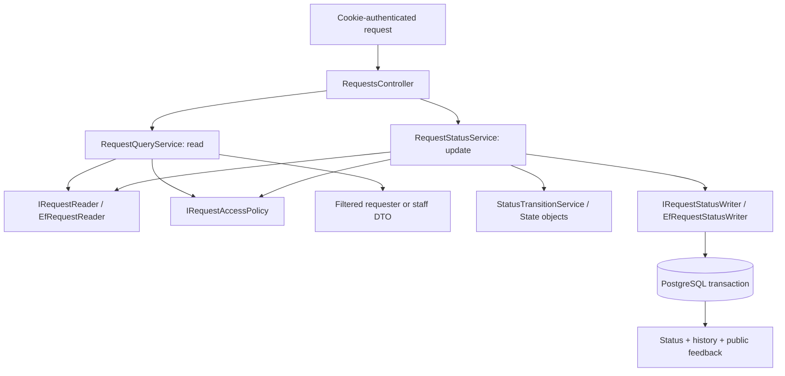

# M3 design and integration

The application remains one deployable unit with logical layers. Controllers handle HTTP and antiforgery; application services coordinate use cases; the access policy decides resource permissions; State objects decide transition legality; EF Core adapters own database operations.

Read access does not grant write access. Only active, unambiguous Staff identities with the matching category can request status changes. Requesters see only their own records and public notes. Management reporting permission does not grant details or mutation permission.

The coordinator loads a snapshot, checks action permission, validates input and current status, asks the State service, then sends one command to the writer. The command includes the server-derived actor and observed version. The writer compares status/version and saves all three required effects atomically. A concurrent category or record change invalidates the checked version. Unexpected database failures reach the generic HTTP 500 boundary.

The State service was absent from supplied main. A small integration dependency was added using Bianca's approved lifecycle and test specifications; Michael remains its allocated implementation owner and must review it. The database writer remains a low-level persistence component, not an independently authorised public entry point.
